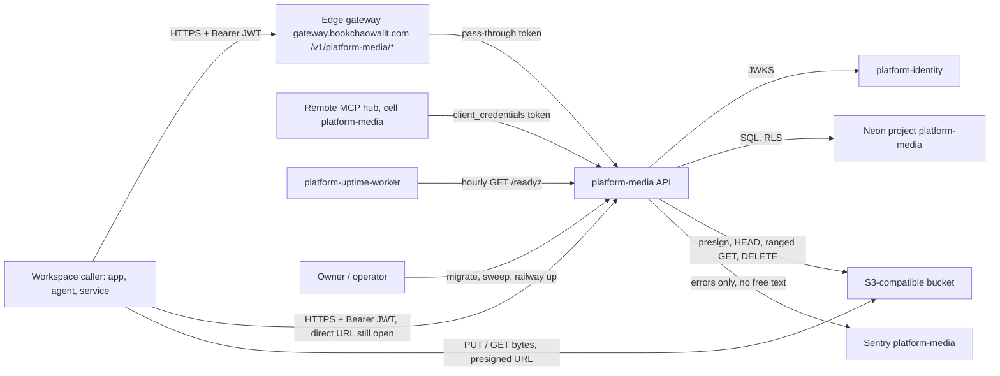
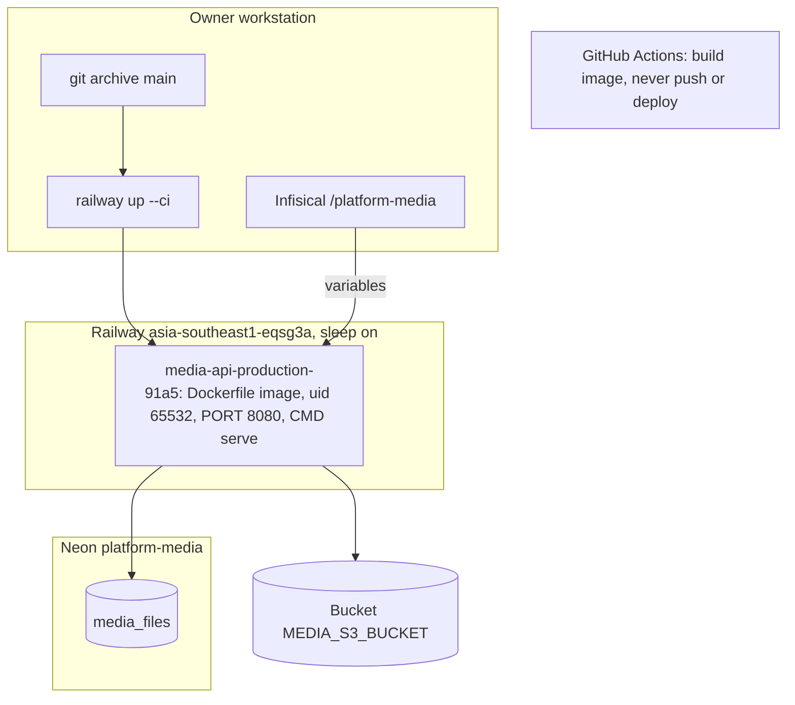

# Book Media Platform — System Architecture

เอกสารนี้สรุปสถาปัตยกรรมของ `platform-media` จากโค้ดและ config ใน repo ณ `origin/main` `b0cbcad` (2026-11-03)
ข้อมูล hosting ที่ไม่อยู่ใน repo อ้างจาก ops record: book-platforms-status (2026-11-03) และ routes ของ platform-api-gateway
รายละเอียดเชิงลึกอยู่ใน Core 22 diagram pack [`docs/diagrams/`](../docs/diagrams/README.md) — เอกสารนี้ลิงก์ไป ไม่คัดลอก

> หมายเหตุ: `00-product-card.md` (2026-10-08) ยังบอกว่าส่วน media "ยังเป็น scaffold" และไม่มี deploy ซึ่งล้าสมัยแล้ว
> (media API มีโค้ดจริงตั้งแต่ 2026-10-15 และ live บน Railway ตั้งแต่ 2026-10-29) — tier ใน `docpack.yaml` ยังเป็น `L0` ตามเดิม

## 1. Architecture style และเหตุผล

| ด้าน | รูปแบบที่ใช้ | เหตุผล / หลักฐาน |
|---|---|---|
| ขอบเขตระบบ | microservice หนึ่งตัวของ Book Platform ("cell" ที่เป็นเจ้าของ code และ DB ของตัวเอง) | `contract.json` (`data_owner: platform-media`), ADR-0001 |
| โครงภายใน | modular monolith ขนาดเล็ก: FastAPI app + adapter ของ object store + CLI สาม command ใน image เดียว | `src/platform_media/__main__.py` (`serve`, `migrate`, `sweep`) |
| shared runtime | สร้างบน `platform-backend-core` ที่ pin commit `21d5f44` (auth, workspace transaction, bounded HTTP, `/healthz` `/metrics`) | `pyproject.toml` `[tool.uv.sources]`, `Dockerfile`, [ADR-0001](../docs/diagrams/08-adr/ADR-0001-fastapi-on-shared-platform-backend-core.md) |
| data path ของไฟล์ | bytes ไม่ผ่าน API: client PUT/GET ตรงกับ S3-compatible store ด้วย presigned URL; API แค่ sign และ verify | `app.py` (`/v1/uploads`, `complete`), [ADR-0002](../docs/diagrams/08-adr/ADR-0002-presigned-direct-upload-with-server-verification.md) |
| multi-tenancy | shared table + PostgreSQL FORCE RLS ต่อ workspace จาก JWT `ws` | `migrations.py`, [ADR-0003](../docs/diagrams/08-adr/ADR-0003-postgres-force-rls-per-workspace.md) |
| hosting | serverless container (sleep เมื่อว่าง) บน Railway Singapore + Neon ของตัวเอง | ops record, [ADR-0004](../docs/diagrams/08-adr/ADR-0004-railway-serverless-cli-deploy.md) |
| ส่วนแยก | Graphics V1A เป็น CLI local (Edge headless) ไม่ได้ deploy และไม่ได้ใช้ใน image | `Dockerfile` comment, `docs/graphics-v1a.md`, `docs/runtime.md` |

## 2. Quality-attribute scenarios

| QA | Scenario (stimulus → response) | กลไกในโค้ด | หลักฐาน |
|---|---|---|---|
| Security / isolation | token ของ workspace A ขอไฟล์ของ workspace B → ไม่เห็นข้อมูล (404) | FORCE RLS `media_workspace` + runtime role `NOSUPERUSER NOBYPASSRLS`; core ตั้ง `app.workspace_id` ต่อ transaction | `migrations.py`, core `db.py`, `runtime_tests/test_api.py` |
| Security / authz | caller ไม่มี scope `files:write` เรียก `POST /v1/uploads` → 403 | `require_scope("files:write" / "files:read")` ทุก route | `app.py` |
| Integrity | client อัปโหลดไฟล์ที่ size/type/SHA256 ไม่ตรงที่ประกาศ → `complete` ปฏิเสธ ไฟล์ไม่เป็น `ready` | presigned PUT sign `Content-Type`, `Content-Length`, `x-amz-checksum-sha256`, `If-None-Match: *`; `complete` ทำ HEAD + อ่าน 16 ไบต์แรกด้วย `If-Match` | `app.py`, `adapters.py` |
| Scalability (payload) | ไฟล์ใหญ่ถึง 100,000,000 bytes → API ไม่ถือ bytes เลย | body cap 1 MiB + timeout 30 s ของ core; ไฟล์ไปที่ store ตรง | `app.py` (`size le=100000000`), ADR-0001/0002 |
| Abuse / capacity | workspace สร้าง pending upload เกิน 1000 รายการที่ยังไม่หมดอายุ → 429 | นับ `status='pending' AND expires_at>now()` ใต้ advisory lock ต่อ workspace | `app.py` (บรรทัด `pending >= 1000`) |
| Idempotency | client ส่ง `POST /v1/uploads` ซ้ำด้วย key เดิม → ได้ intent เดิม ไม่สร้างแถวใหม่ | `ON CONFLICT(workspace_id,idempotency_key) DO NOTHING` + fingerprint | `app.py` |
| Availability (cold start) | request แรกหลัง service/Neon หลับ → ตอบได้ภายใน pool wait 20 s / connect 15 s | core `21d5f44` pool check + timeout | ops record (core fixes), core `db.py` |
| Concurrency | request พร้อมกันเกิน 64 → uvicorn ปฏิเสธส่วนเกิน (503) แทนการรอไม่จำกัด | `limit_concurrency=64`, pool max 8 | `__main__.py` |
| Privacy (telemetry) | exception มีชื่อไฟล์หรือ token → Sentry ไม่ได้รับข้อความนั้น | `_scrub_event` ลบ value/message/breadcrumbs/request; `CaptureErrors` ชั้นในสุด | `_sentry.py`, [ADR-0005](../docs/diagrams/08-adr/ADR-0005-sentry-errors-only-no-free-text.md) |
| Readiness | DB grant ผิดหรือ migration checksum ไม่ตรง → `/readyz` ไม่ตอบ 200 | `/readyz` เช็ค store config, grants ทีละตัว, checksum, FORCE RLS | `app.py` (`readyz`), `runtime_tests/test_readiness_grants.py` |

## 3. Context diagram

ภาพ C4 แบบเต็ม: [05-c4-context.md](../docs/diagrams/05-c4-context.md), [06-c4-container.md](../docs/diagrams/06-c4-container.md), [07-c4-component.md](../docs/diagrams/07-c4-component.md)

## 4. Components / containers

| Container / module | เทคโนโลยี | หน้าที่ | หลักฐาน |
|---|---|---|---|
| media API (`serve`) | Python 3.12, FastAPI, uvicorn, core `21d5f44` | `/v1/uploads`, `/v1/uploads/{id}/complete`, `/v1/files`, `/v1/files/{id}`, `/v1/files/{id}/download`, `DELETE /v1/files/{id}`, `/healthz`, `/readyz` (override), `/metrics` | `app.py`, `__main__.py` |
| `migrate` | CLI ใน image เดียวกัน | apply `001-media`, `002-media-sweep` ด้วย `DATABASE_MIGRATION_DSN` (owner role); `serve` ไม่ migrate เอง | `migrations.py`, `__main__.py` |
| `sweep` | CLI | ลบ orphan object ของ upload ที่หมดอายุ ทีละ batch ต่อ `MEDIA_WORKSPACE_ID` | `sweeper.py` |
| `adapters.S3ObjectStore` | boto3 S3v4 | presign PUT/GET, HEAD, ranged GET, delete; ต้องมี credential explicit + HTTPS endpoint | `adapters.py`, `config.py` |
| `_sentry` | sentry-sdk | opt-in เมื่อมี `SENTRY_DSN`; scrub + `CaptureErrors` | `_sentry.py` |
| Graphics V1A | Python + Microsoft Edge headless | `python -m book_media_platform.graphics build/benchmark` บนเครื่อง local เท่านั้น | `book_media_platform/graphics/`, `docs/graphics-v1a.md` |

Component view (C4 level 3): [07-c4-component.md](../docs/diagrams/07-c4-component.md)

## 5. Tech stack

| ชั้น | เทคโนโลยี | หลักฐาน |
|---|---|---|
| Runtime | Python 3.12 (`requires-python >=3.12`; check job ทดสอบ 3.11 ด้วยสำหรับส่วน stdlib) | `pyproject.toml`, `.github/workflows/check.yml` |
| Web | FastAPI ผ่าน core, uvicorn `>=0.30,<1` | `pyproject.toml` |
| Shared core | `platform-backend-core` git rev `21d5f44d26220080cbed43b9807979dc84a8533a` | `pyproject.toml`, `Dockerfile`, `uv.lock` |
| Storage client | boto3 `>=1.40,<2` | `pyproject.toml` |
| Observability | sentry-sdk `>=2.72,<3`, `/metrics` ของ core | `pyproject.toml`, `_sentry.py` |
| Build | 2-stage `python:3.12-slim`, wheel จาก clean checkout, user `65532:65532` | `Dockerfile` |
| Quality tools | uv lock, Ruff 0.17.1, mypy 2.4.0, pytest-cov | `pyproject.toml`, `shared-runtime.yml` |

## 6. Data stores

| Store | ข้อมูล | หมายเหตุ | หลักฐาน |
|---|---|---|---|
| PostgreSQL (Neon project `platform-media`) | ตาราง `media_files` (metadata, status, object key, checksum, expiry, sweep state) + `platform_schema_migrations` ของ core | FORCE RLS; runtime role มีแค่ SELECT/INSERT/UPDATE (ไม่มี DELETE) | `migrations.py`, [09-erd.md](../docs/diagrams/09-erd.md) |
| Object store bucket (`MEDIA_S3_BUCKET`) | bytes ของไฟล์, key `<workspace>/<uuid>` สร้างโดย server | lifecycle rules ตั้งแล้ว (abort multipart 1 วัน, `scratch/` 7 วัน) ตาม ops record; region default `auto` | `adapters.py`, `config.py`, ops record |
| Local output dir (Graphics) | SVG, PNG, `manifest.json`, `.locks` | ไม่อยู่บน production | `book_media_platform/graphics/service.py` |

## 7. Integrations

| ระบบ | ทิศทาง | ใช้ทำอะไร | สถานะ / หลักฐาน |
|---|---|---|---|
| platform-identity (issuer + JWKS) | media → identity | verify RS256 JWT, audience `media-api`; JWKS refresh สูงสุดทุก 60 s | live; env `JWT_ISSUER`, `JWT_AUDIENCE`, `JWT_JWKS_URL` (หรือ `JWT_PUBLIC_KEY`); ops record |
| Edge gateway `gateway.bookchaowalit.com` | caller → gateway → media | ingress `/v1/platform-media/<path>`; gateway verify token แล้วส่ง token เดิมต่อ service ยังเช็ค audience/scope เอง | route `platform-media` ใน platform-api-gateway `routes.json` @ `4a31ff5`; service ไม่ได้เช็ค `X-Gateway-Assertion` จึงยังเรียก URL ตรงได้ |
| Remote MCP hub | hub → media | cell `platform-media` ผ่าน identity client `mcp-hub` | ops record (2026-11-03) |
| S3-compatible store | media ↔ store, caller ↔ store | presign และ verify (`MEDIA_S3_ENDPOINT`, `MEDIA_S3_BUCKET`, `MEDIA_S3_ACCESS_KEY`, `MEDIA_S3_SECRET_KEY`, `MEDIA_S3_REGION`) | `config.py`; provider จริง (R2?) ดู Open questions |
| Neon PostgreSQL | media → DB | `DATABASE_URL` (runtime), `DATABASE_MIGRATION_DSN` (migrate), `DATABASE_POOL_MAX` | `__main__.py`, ops record |
| Sentry | media → Sentry | error events ที่ไม่มี free text; `SENTRY_DSN`, `SENTRY_ENVIRONMENT`, `SENTRY_RELEASE` | `_sentry.py`; project `platform-media` (ops record) |
| platform-uptime-worker | uptime → media | `GET /readyz` ทุกชั่วโมง (sleeping set) | ops record |
| Queues / Kafka | — | ไม่มี: media ไม่ publish/consume event | ไม่พบใน `src/` |
| `security`, `observability` platform | ประกาศใน `contract.json` `depends_on` | ยังไม่มีการเรียกจริงในโค้ด | `contract.json`, [05-c4-context.md](../docs/diagrams/05-c4-context.md) |

## 8. Deployment topology

- deploy เป็น CLI upload จาก `git archive main`; push เข้า `main` ไม่ deploy เอง (CI job `image` build แต่ไม่ push) — `shared-runtime.yml`, ADR-0004
- รายละเอียด: [16-deployment.md](../docs/diagrams/16-deployment.md), [15-cicd-pipeline.md](../docs/diagrams/15-cicd-pipeline.md)

## 9. ADR สำคัญ

| ID | การตัดสินใจ | ไฟล์ |
|---|---|---|
| ADR-0001 | FastAPI บน `platform-backend-core` ที่ pin `21d5f44` ในสามที่พร้อม test กันเพี้ยน | [ADR-0001](../docs/diagrams/08-adr/ADR-0001-fastapi-on-shared-platform-backend-core.md) |
| ADR-0002 | bytes ไป S3-compatible store ตรง; API sign และ verify เท่านั้น | [ADR-0002](../docs/diagrams/08-adr/ADR-0002-presigned-direct-upload-with-server-verification.md) |
| ADR-0003 | PostgreSQL FORCE RLS ต่อ workspace, migration แยก role | [ADR-0003](../docs/diagrams/08-adr/ADR-0003-postgres-force-rls-per-workspace.md) |
| ADR-0004 | Railway serverless Singapore, deploy ด้วย CLI | [ADR-0004](../docs/diagrams/08-adr/ADR-0004-railway-serverless-cli-deploy.md) |
| ADR-0005 | Sentry errors only, ไม่ส่ง free text | [ADR-0005](../docs/diagrams/08-adr/ADR-0005-sentry-errors-only-no-free-text.md) |

## 10. Fitness functions (สิ่งที่ guard สถาปัตยกรรมอยู่แล้ว)

| สิ่งที่ guard | Check | ที่รัน |
|---|---|---|
| core pin ตรงกันใน `pyproject.toml`, `Dockerfile`, CI; image multi-stage, non-root, ไม่ push | `tests/test_build_hygiene.py` | `check.yml` → `scripts/check.sh` |
| ทุก action ใน workflow pin ด้วย SHA เต็ม | `test_every_workflow_action_is_sha_pinned` | `check.yml` |
| contract schema ไม่เพี้ยนจาก canonical, contract ตรง registry | `scripts/check_schema_pin.py`, `scripts/check_registry_alignment.py`, `tests/test_drift_checks.py`, `scripts/check.py` | `check.yml`, `shared-runtime.yml` |
| readiness ปฏิเสธ grant เกิน/ขาด และ RLS ที่ไม่ FORCE | `runtime_tests/test_readiness_grants.py` | `shared-runtime.yml` (Postgres จริง) |
| workspace isolation และ upload flow | `runtime_tests/test_api.py`, `runtime_tests/test_sweeper.py` | `shared-runtime.yml` |
| ไม่มี free text ออกไป Sentry | `tests/test_sentry.py`, `runtime_tests/test_sentry_boundary.py` (real-client 55 case ตาม ops record) | `shared-runtime.yml` |
| coverage ไม่ต่ำกว่า 72% | `pytest --cov-fail-under=72` | `shared-runtime.yml` |
| lint / type | Ruff + mypy บน locked env | `shared-runtime.yml` |
| image import service ได้และรันเป็น non-root | job `image` | `shared-runtime.yml` |
| dependency / secret scan | reusable `security.yml` @ `87dc5e1c` (v1.1.1) | `check.yml` |
| renderer Graphics ครบ 6 case (optional) | `scripts/check_graphics_renderer.py` บน `windows-latest` | `graphics-renderer.yml` |

## 11. เอกสารลงรายละเอียด phase 07

| Template | สถานะ | ลิงก์ / เหตุผล |
|---|---|---|
| `sdlc/infrastructure-and-network-design.md` | partial (ใช้ diagram แทน) | [16-deployment.md](../docs/diagrams/16-deployment.md), [19-service-dependency-map.md](../docs/diagrams/19-service-dependency-map.md); ยังไม่มี template ฉบับเต็ม (DNS/TLS/edge) |
| `sdlc/observability-design.md` | partial | [20-observability.md](../docs/diagrams/20-observability.md); ไม่มี SLO ที่กำหนดไว้ |
| `sdlc/capacity-performance-and-cost-plan.md` | not_applicable | tier L0, ไม่มี load test หรือ cost model ใน repo; bounds ที่มีอยู่สรุปใน §2 |
| `sdlc/failure-mode-analysis.md` | partial | [13-threat-model.md](../docs/diagrams/13-threat-model.md), [14-backup-dr.md](../docs/diagrams/14-backup-dr.md), [21-incident-response.md](../docs/diagrams/21-incident-response.md) |
| `sdlc/async-integration-contract.md` | partial | async งานเดียวคือ `sweep` (batch CLI, ไม่มี scheduler); state ใน [11-state-machines.md](../docs/diagrams/11-state-machines.md); ไม่มี queue/event |
| `sdlc/frontend-architecture.md` | not_applicable | ไม่มี UI; เป็น API + CLI |
| `sdlc/tech-debt-register.md` | partial | [`docs/UPGRADE-PLAN.md`](../docs/UPGRADE-PLAN.md) |
| `operations/system-landscape.md` | done (row มีแล้ว) | architecture-docs `operations/platform/SYSTEM-LANDSCAPE-GENERATED.md` @ `2107a91`: `platform-media` online, railway/serverless, capability Data & Knowledge |
| `development-cycle/vendor-dependency-review.md` | not_applicable (ยังไม่ทำ) | vendor: Railway, Neon, S3 provider, Sentry — free tier ทั้งหมดตาม ops record; ยังไม่มี exit plan |

## 12. Open questions

- object store จริงเป็น Cloudflare R2 หรือ provider อื่น (default region `auto` ชี้ไปทาง R2 แต่ไม่มีบันทึกใน repo)
- จะปิดการเรียก Railway URL ตรงหลัง gateway cutover หรือไม่ (service ยังไม่เช็ค `X-Gateway-Assertion`)
- `sweep` จะรันจาก scheduler ไหน และ bucket CORS ต้องการ origin ใด (owner follow-up ใน ops record)
- `00-product-card.md` และ verdict `merge` ยังสะท้อนสถานะ 2026-10-08 — ควรทบทวน product card / tier
- `security` และ `observability` ใน `depends_on` จะ wire เมื่อไร หรือควรถอดออกจาก contract

## การอนุมัติ

| บทบาท | สถานะ | วันที่ | ลงนาม |
|---|---|---|---|
| Solution Architect (Book Dev) | รอตรวจ | — | [ต้องยืนยัน] |
| Owner | รอตรวจ | — | [ต้องยืนยัน] |

## แหล่งข้อมูล

- repo `platform-media` ที่ `origin/main` `b0cbcad` (2026-11-03)
- `pyproject.toml`, `Dockerfile`, `uv.lock`, `contract.json`, `DOCPACK/docpack.yaml`, `DOCPACK/00-product-card.md`
- `src/platform_media/__main__.py`, `app.py`, `adapters.py`, `config.py`, `migrations.py`, `sweeper.py`, `_sentry.py`
- `book_media_platform/graphics/`
- `.github/workflows/check.yml`, `shared-runtime.yml`, `graphics-renderer.yml`; `scripts/*.py`, `scripts/check.sh`
- `tests/*.py`, `runtime_tests/*.py`
- `docs/runtime.md`, `docs/CONTRACT-SURFACE.md`, `docs/UPGRADE-PLAN.md`, `docs/graphics-v1a.md`, `docs/diagrams/*` (pack ที่ `f3b4a72`)
- platform-api-gateway `routes.json` และ `README.md` @ `4a31ff5`
- architecture-docs `operations/platform/SYSTEM-LANDSCAPE-GENERATED.md` @ `2107a91`
- ops record: book-platforms-status (2026-11-03), api-gateway-edge (2026-11-03)
