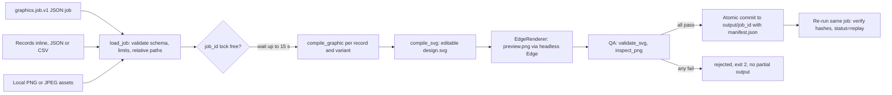
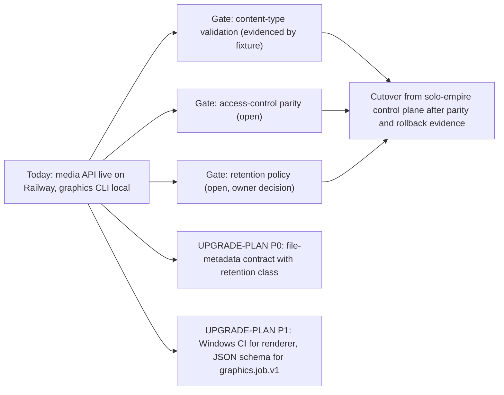

# 01 — Business process (As-Is / To-Be)

platform-media เป็น backend platform service ของ Book Platform ที่เป็นเจ้าของ capability `media`
(signed upload, file metadata, object storage, image processing) ตาม `contract.json`
ใน repo มีของสองชิ้น: (1) media API บน FastAPI/PostgreSQL ใน `src/platform_media/` และ (2) Graphics V1A
CLI แบบ deterministic ใน `book_media_platform/graphics/` ที่รันบนเครื่อง local เท่านั้น

## As-Is: file lifecycle ผ่าน media API (จากโค้ดวันนี้)

ไบต์ของไฟล์ไม่ผ่าน API: caller ขอ intent, PUT ไบต์ตรงไปที่ object store ด้วย presigned URL, แล้วสั่ง complete
ให้ API ตรวจ HEAD + 16 ไบต์แรก ก่อนเปลี่ยนเป็น `ready`

```mermaid
flowchart LR
  A["Caller with workspace JWT"] --> B["POST /v1/uploads with Idempotency-Key"]
  B --> C{"New key?"}
  C -->|"yes, under 1000 pending"| D["Insert media_files row status=pending"]
  C -->|"same key, same payload"| E["Return existing intent 200"]
  C -->|"same key, other payload"| X1["409 conflict"]
  D --> F["Return presigned PUT url and signed headers 201"]
  E --> F
  F --> G["Caller PUTs bytes directly to S3-compatible bucket"]
  G --> H["POST /v1/uploads/id/complete"]
  H --> I["HEAD object: size, type, SHA256, ETag"]
  I --> J["Ranged GET 16 bytes with If-Match ETag"]
  J --> K{"Signature matches declared type?"}
  K -->|"yes"| L["status=ready"]
  K -->|"no"| X2["409, stays pending"]
  L --> M["GET /v1/files/id/download: presigned GET 300 s"]
  L --> N["DELETE /v1/files/id"]
  N --> O["status=deleting, delete object, status=deleted tombstone"]
  O --> P["Operator: python -m platform_media sweep per workspace"]
  P --> Q["Delete orphan objects after expiry plus 900 s grace, stamp swept_at"]
```

Sources: `src/platform_media/app.py`, `src/platform_media/adapters.py`, `src/platform_media/sweeper.py`, `src/platform_media/__main__.py`, `docs/runtime.md`

## As-Is: Graphics V1A template batch (local CLI)

Sources: `book_media_platform/graphics/cli.py`, `book_media_platform/graphics/service.py`, `book_media_platform/graphics/inputs.py`, `book_media_platform/graphics/qa.py`, `book_media_platform/graphics/renderer.py`, `docs/graphics-v1a.md`, `docs/CONTRACT-SURFACE.md`

## To-Be

แหล่ง To-Be ที่มีใน repo: `PRODUCT.md`, `docs/UPGRADE-PLAN.md` และ "Migration gate" ใน `README.md`
(ไม่มี `specs/`) สิ่งที่เขียนไว้ชัดเจน:

Sources: `PRODUCT.md`, `docs/UPGRADE-PLAN.md`, `README.md` (Migration gate), `contract.json` (`migration`, `migration_gates`), `docs/CONTRACT-SURFACE.md`

## Open questions

- PRODUCT.md ยังเขียนว่า "not a running service / runtime not activated" แต่ ops record: book-platforms-status (2026-11-03) บอกว่า `media-api-production-91a5` live บน Railway แล้ว: ต้องให้ owner อัปเดต PRODUCT.md / contract status (`pilot`)
- ใครคือ consumer จริงรายแรกของ media API (app ไหนจะ upload) ยังไม่มีในโค้ดหรือเอกสาร
- เกณฑ์ cutover ("[ต้องยืนยัน]" ใน PRODUCT.md) ยังไม่ได้กำหนด
- Graphics V1A จะย้ายเป็น hosted job หรือคงเป็น CLI local: ไม่มีแผนเขียนไว้
