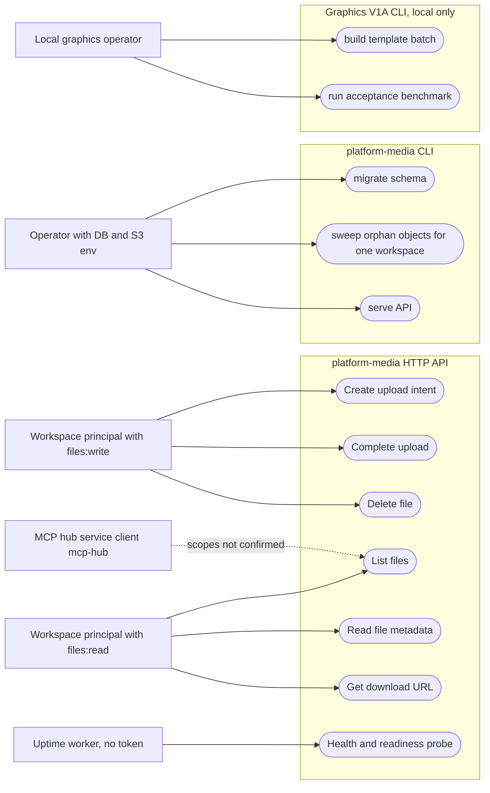

# 02 — Use cases

Actors คือ principal ที่ service ตรวจจริง: JWT RS256 ที่ `TokenVerifier` (platform-backend-core `21d5f44`)
ต้องมี claim `sub`, `ws`, `iat`, `exp`, `jti`, `iss`, `aud` และ scope แบบ concrete
media ตรวจแค่สอง scope: `files:write` และ `files:read` (ไม่มี wildcard/owner shortcut)
token ที่มี `del` หรือ `obo` ถูกปฏิเสธ ส่วน operator คือคนที่รัน CLI `migrate` / `sweep` ด้วย env ของตัวเอง ไม่ผ่าน HTTP

ตาม ops record: book-platforms-status (2026-11-03) issuer คือ platform-identity
(`https://identity-api-production-fad1.up.railway.app`, JWKS `/.well-known/jwks.json`) และ audience `<svc>-api`
(สำหรับ service นี้คือ `media-api`) ส่วน token มาจาก person token (Google, ยังรอ client ID) หรือ service client (`client_credentials`)

Sources: `src/platform_media/app.py` (`require_scope("files:write")`, `require_scope("files:read")`), `src/platform_media/__main__.py`, `book_media_platform/graphics/cli.py`, platform-backend-core `21d5f44` `src/platform_backend_core/auth.py` and `http.py`, `docs/runtime.md` (Versioned API), ops record: book-platforms-status (2026-11-03)

| Actor | ตรวจอย่างไร | Use cases |
|---|---|---|
| Workspace principal (`files:write`) | JWT `ws` = tenant, `sub` = actor_id ที่บันทึกใน `media_files.actor_id` | create intent, complete, delete |
| Workspace principal (`files:read`) | JWT `ws` เดียวกัน, RLS `app.workspace_id` | list, metadata, download |
| MCP hub (`mcp-hub` service client) | client_credentials token ต่อ audience | ops record ระบุว่า media เป็น cell `platform-media` ใน hub แต่ไม่ระบุ scope ของ media |
| Operator | ถือ `DATABASE_MIGRATION_DSN` / `DATABASE_URL` + `MEDIA_S3_*` + `MEDIA_WORKSPACE_ID` | migrate, sweep, serve |
| Uptime worker | ไม่มี token, เรียก `/readyz` | probe |
| Graphics operator | ไม่มี auth, รันบนเครื่อง local | build, benchmark |

## Open questions

- hub cell `platform-media` ได้ `files:read` / `files:write` หรือไม่ (ops record ไม่ได้ระบุ scope ของ media)
- ยังไม่มี person-token call จริงไปที่ media (รอ `IDENTITY_GOOGLE_CLIENT_IDS` ตาม ops record)
- ไม่มีบทบาท admin / cross-workspace ในโค้ด: ถ้าต้องการ (เช่น audit) ต้องออกแบบใหม่
