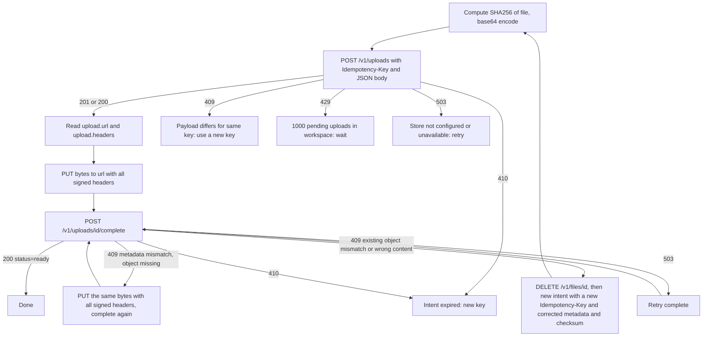
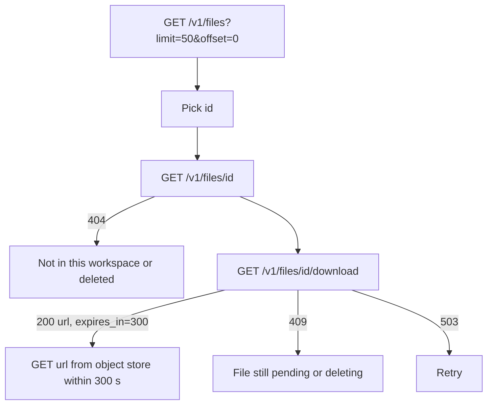
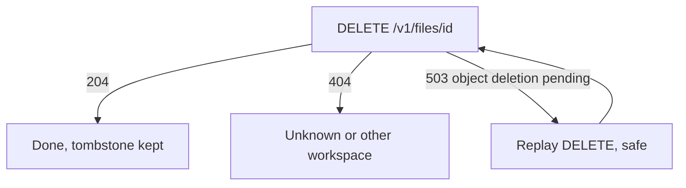
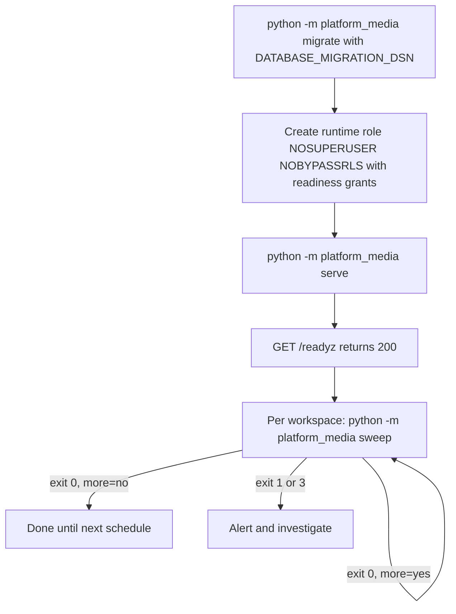

# 03 — User flows (API call flows per caller)

service นี้ไม่มี UI: "user flow" คือลำดับการเรียก API ของ caller แต่ละแบบ ตาม router ใน `src/platform_media/app.py`

## Flow A: uploader (`files:write`) — upload ไฟล์จนพร้อมใช้

## Flow B: reader (`files:read`) — หาและดาวน์โหลดไฟล์

## Flow C: deleter (`files:write`)

## Flow D: operator (CLI)

Sources: `src/platform_media/app.py`, `src/platform_media/__main__.py`, `docs/runtime.md` (Versioned API, Orphan-object sweeper, Staged deployment), ops record: book-platforms-status (2026-11-03, "Database roles" recipe)

## Open questions

- ไม่มี client SDK หรือ consumer ใน repo: flow ข้างบนมาจากสัญญา API ไม่ใช่จาก app ที่เรียกจริง
- Browser upload ต้องตั้ง bucket CORS ซึ่ง ops record ระบุว่ายังรอ app origins จาก owner
- ตาราง schedule ของ `sweep` ต่อ workspace ยังไม่มี (owner follow-up ใน ops record)
