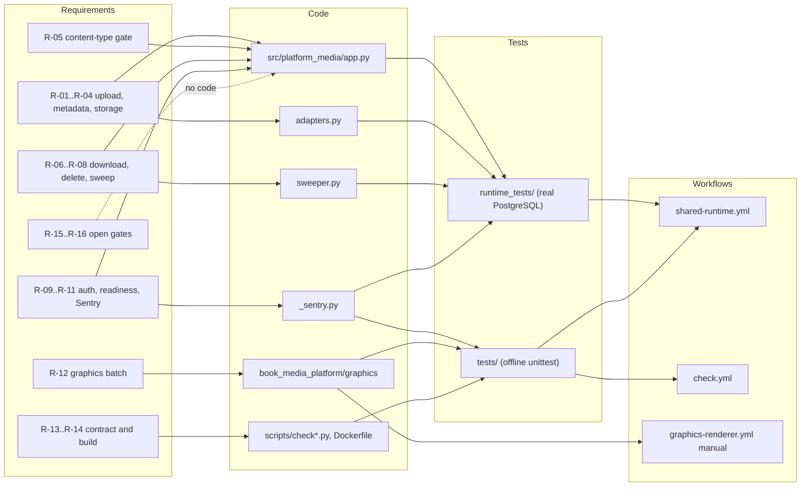

# 04 — Traceability (RTM)

repo นี้ไม่มี `specs/` แหล่ง requirement คือ `contract.json` (capabilities, migration_gates, interfaces),
`PRODUCT.md` (Measures) และพฤติกรรมที่ `docs/runtime.md` สัญญาไว้ ID `R-xx` ด้านล่างตั้งขึ้นในเอกสารนี้เพื่ออ้างอิงเท่านั้น

| ID | Requirement (source) | Code module | Test file(s) | Release / workflow |
|---|---|---|---|---|
| R-01 | signed-upload: intent + presigned PUT, idempotent per key (`contract.json`, `runtime.md` Versioned API) | `src/platform_media/app.py` `upload`, `adapters.py` `presign_put` | `runtime_tests/test_api.py` (`test_upload_intent_is_bound_idempotent_and_workspace_isolated`, `test_concurrent_uploads_and_force_rls`, `test_actual_s3_adapter_binds_conditional_put_length_type_checksum_and_expiry`) | `shared-runtime.yml` job `runtime`; CLI deploy (ops record) |
| R-02 | Pending quota 1000 per workspace, replay still works (`runtime.md`) | `app.py` `upload` | `runtime_tests/test_api.py` `test_pending_upload_queue_is_bounded_per_workspace_and_replay_still_works` | `shared-runtime.yml` |
| R-03 | file-metadata: list / metadata, workspace isolated (`contract.json`) | `app.py` `files`, `metadata`, `migrations.py` RLS policy | `runtime_tests/test_api.py` `test_upload_intent_...`, `test_two_independent_api_pools_share_intent_and_rls` | `shared-runtime.yml` |
| R-04 | object-storage: complete verifies HEAD + checksum + ETag-bound prefix (`runtime.md` S3/R2) | `app.py` `complete`, `adapters.py` `head`, `read_prefix` | `runtime_tests/test_api.py` (`..._swapped_between_head_and_read`, `..._no_etag`, `..._holds_no_row_lock_while_calling_the_store`, `test_s3_adapter_binds_the_range_read_to_the_headed_etag`) | `shared-runtime.yml` |
| R-05 | Gate: content-type validation (`contract.json` migration_gates, `fixtures/gates/media-content-type.json`) | `app.py` `ALLOWED_CONTENT_TYPES`, `SIGNATURE_BYTES` | `runtime_tests/test_api.py` (`test_content_type_gate_fixture_covers_every_allowed_type`, `test_completion_requires_stored_bytes_to_match_declared_content_type`, `test_content_check_fails_closed_on_missing_or_unreadable_bytes`, `test_s3_adapter_reads_only_a_bounded_range_for_the_content_check`) | `shared-runtime.yml` |
| R-06 | Download only for ready files, 300 s URL (`runtime.md`) | `app.py` `download`, `adapters.py` `presign_get` | `runtime_tests/test_api.py` `test_upload_intent_...` (download 409 before ready, 200 after, 404 after delete) | `shared-runtime.yml` |
| R-07 | Delete is replay-safe, tombstone kept, late PUT purged in window (`runtime.md` F1b) | `app.py` `delete`, `purge_late_object` | `runtime_tests/test_api.py` `test_delete_during_verification_wins_and_completion_cleans_up`, `test_late_put_after_delete_is_removed_within_the_upload_window` | `shared-runtime.yml` |
| R-08 | Orphan sweep per workspace, exit codes 0/1/2/3 (`runtime.md` Orphan-object sweeper) | `src/platform_media/sweeper.py`, `__main__.py` `sweep_command`, migration `002-media-sweep` | `runtime_tests/test_sweeper.py` (10 tests) | `shared-runtime.yml` |
| R-09 | Auth from verified JWT and concrete scope only (`contract.json` interface auth) | core `require_scope`, `TokenVerifier`; `__main__.py` serve config | `runtime_tests/test_api.py` `test_authorization_is_from_real_verified_jwt_and_concrete_scope`, `test_expiry_limits_and_no_caller_authority` | `shared-runtime.yml` |
| R-10 | Readiness fails closed: store, grants, migrations, FORCE RLS (`runtime.md` Effective runtime grants) | `app.py` `readiness`, `READINESS_PERMISSIONS` | `runtime_tests/test_readiness_grants.py`, `runtime_tests/test_api.py` `test_readiness_requires_provider_and_migrated_rls_schema`, `test_missing_store_fails_closed`, `runtime_tests/test_sweeper.py` `test_readiness_requires_the_sweep_migration` | `shared-runtime.yml` |
| R-11 | No free text to Sentry (ops record 2026-11-03, `_sentry.py` docstring) | `src/platform_media/_sentry.py` | `tests/test_sentry.py` (12), `runtime_tests/test_sentry_boundary.py` (2) | `check.yml`, `shared-runtime.yml` |
| R-12 | graphics-template-batch / image-processing: job to SVG + PNG, atomic, replay (`contract.json`, `docs/graphics-v1a.md`) | `book_media_platform/graphics/*` | `tests/test_graphics.py` (20), `tests/test_job_lock.py` (18), `tests/test_graphics_renderer.py` (6, skipped in hosted CI) | `check.yml`, `shared-runtime.yml`; renderer gate `graphics-renderer.yml` (manual, Windows) |
| R-13 | Contract valid vs pinned schema, docs agree (`PRODUCT.md` Measures) | `scripts/check.py`, `scripts/check_schema_pin.py`, `scripts/check_registry_alignment.py` | `tests/test_contract_check.py` (19), `tests/test_drift_checks.py` (18) | `check.yml` (`scripts/check.sh`) |
| R-14 | Image builds from clean checkout, non-root, SHA-pinned actions (`runtime.md` Container image) | `Dockerfile`, workflows | `tests/test_build_hygiene.py` (8) | `shared-runtime.yml` job `image` |
| R-15 | Gate: access-control parity (`contract.json`) | none | none | open |
| R-16 | Gate: retention policy (`contract.json`) | none (ready objects stay until DELETE) | none | open, owner decision |

Sources: `contract.json`, `PRODUCT.md`, `docs/runtime.md`, `docs/CONTRACT-SURFACE.md`, `fixtures/gates/media-content-type.json`, `src/platform_media/*.py`, `runtime_tests/*.py`, `tests/*.py`, `.github/workflows/*.yml`

## Open questions

- ยังไม่มี spec ตาม ADR-0004 (SDD, Given/When/Then) สำหรับ media: ต้องการให้เขียน spec ย้อนหลังหรือไม่
- R-15 access-control parity: `docs/runtime.md` บอกว่าไม่มี legacy implementation ให้เทียบ ต้องให้ owner ตัดสินว่าปิด gate นี้อย่างไร
- release ไม่ผูกกับ tag / version ใน git: deploy เป็น CLI (ops record) จึงไม่มี link อัตโนมัติจาก commit ไปยัง release
