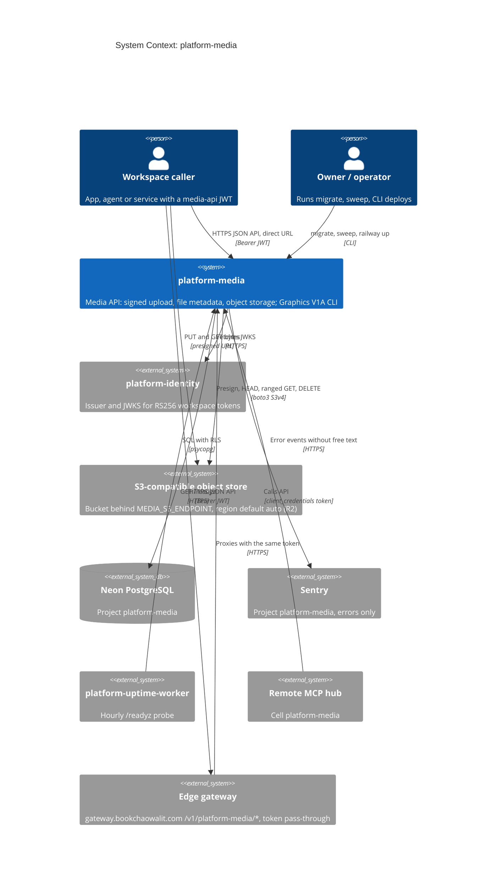

# 05 — C4 Context

Sources: `src/platform_media/app.py`, `src/platform_media/adapters.py`, `src/platform_media/config.py`, `src/platform_media/_sentry.py`, `src/platform_media/__main__.py`, `docs/runtime.md`, `contract.json` (`depends_on`), ops record: book-platforms-status (2026-11-03: Railway service, Neon project, Sentry project, uptime worker, MCP hub cell, identity issuer), platform-api-gateway `routes.json` + `README.md` @ `4a31ff5` (route `platform-media` → `https://media-api-production-91a5.up.railway.app`; added 2026-11-04)

`contract.json` ประกาศ `depends_on: identity, security, observability` แต่ในโค้ดวันนี้มีการเรียกจริงแค่ identity (JWKS)
ไม่มีการเรียก security หรือ observability service

## Open questions

- gateway มี route `platform-media` แล้ว (`routes.json` @ `4a31ff5`) แต่ README ของ gateway บอกว่า direct URL ยังใช้ได้จนกว่าจะบันทึก cutover และ media ไม่เช็ค `X-Gateway-Assertion`: caller ตัวไหนย้ายมา gateway แล้ว และจะปิด direct URL เมื่อไร
- object store จริงคือ Cloudflare R2 หรือ provider อื่น: โค้ดรับ endpoint ใดก็ได้ที่เป็น HTTPS, default region `auto` ชี้ไปทาง R2 แต่ไม่มีบันทึกยืนยัน
- dependency `security` และ `observability` ใน contract จะ wire เมื่อไร
