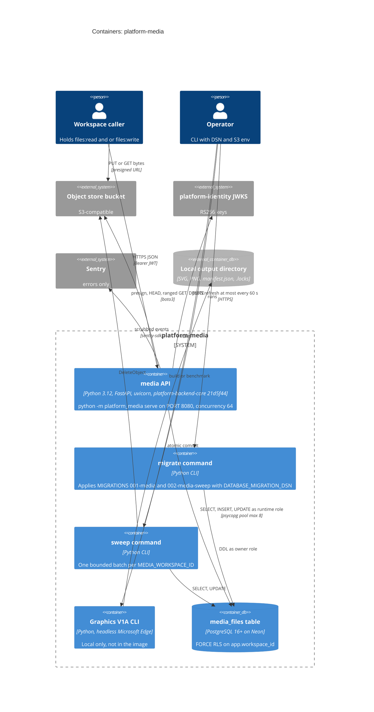

# 06 — C4 Container

Sources: `Dockerfile`, `pyproject.toml`, `src/platform_media/__main__.py`, `src/platform_media/app.py`, `src/platform_media/migrations.py`, `src/platform_media/sweeper.py`, `src/platform_media/adapters.py`, `book_media_platform/graphics/cli.py`, `book_media_platform/graphics/renderer.py`, `docs/runtime.md` (Container image), platform-backend-core `21d5f44` `db.py`, `auth.py`

ใน image มีแค่ `serve` เป็น `CMD`; `migrate` และ `sweep` ใช้ image เดียวกันแบบ command override (`docs/runtime.md`)
Graphics package ถูก install ใน image ด้วย แต่ render ไม่ได้เพราะไม่มี Edge / Arial

## Open questions

- `sweep` ยังไม่มี scheduler (Railway cron / GH Actions) ตาม ops record: ใครจะเป็น trusted scheduler
- `migrate` บน production รันจากเครื่อง owner หรือจาก one-off Railway run: ไม่มีบันทึกใน repo
