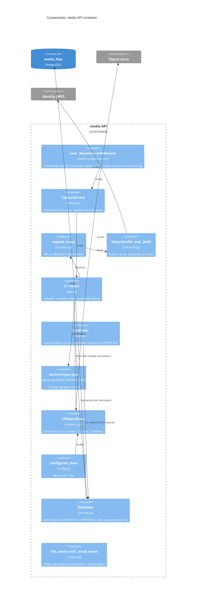
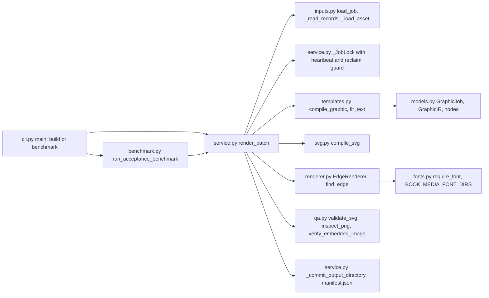

# 07 — C4 Component

## media API

Sources: `src/platform_media/app.py`, `src/platform_media/adapters.py`, `src/platform_media/config.py`, `src/platform_media/_sentry.py`, `src/platform_media/__init__.py`, platform-backend-core `21d5f44` `src/platform_backend_core/http.py`, `auth.py`, `db.py`

## Graphics V1A

Sources: `book_media_platform/graphics/cli.py`, `service.py`, `benchmark.py`, `inputs.py`, `templates.py`, `models.py`, `svg.py`, `renderer.py`, `fonts.py`, `qa.py`
