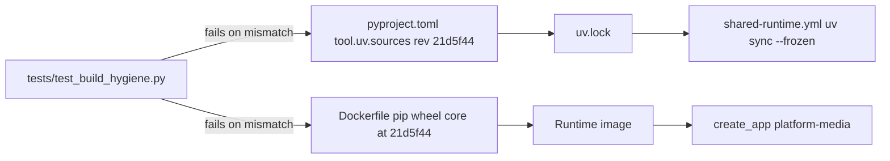

# ADR-0001 — FastAPI service on a pinned copy of platform-backend-core

- Status: accepted (retro-documented)
- Date of evidence: 2026-10-15 (runtime added) to 2026-11-03 (current pin)

## Context

Book Platform services ต้องมี auth, workspace isolation, bounded request และ diagnostics แบบเดียวกัน
แต่ตาม decision "cells own their code" แต่ละ repo เป็นเจ้าของ code ของตัวเอง

## Decision

media API สร้างบน FastAPI ผ่าน `platform_backend_core.create_app("platform-media", database, verifier)`
และ pin core ที่ commit `21d5f44d26220080cbed43b9807979dc84a8533a` ในสามที่พร้อมกัน: `pyproject.toml`
`[tool.uv.sources]`, `Dockerfile` และ lock `uv.lock` โดย `tests/test_build_hygiene.py` fail ถ้า pin ไม่ตรงกัน
core ให้ `/healthz`, `/readyz` (media override เอง), `/metrics`, body cap 1 MiB, timeout 30 s, redacted 500

Sources: `pyproject.toml`, `Dockerfile`, `uv.lock`, `.github/workflows/shared-runtime.yml`, `tests/test_build_hygiene.py`, `src/platform_media/app.py`, `docs/runtime.md` (Container image), ops record: book-platforms-status (2026-11-03, "Other services still pin core 21d5f44")

## Consequences

- อัปเกรด core ต้องเปลี่ยนสามที่ใน commit เดียว; ป้องกัน dependency confusion เพราะ core ไม่อยู่บน PyPI
- core ที่ใหม่กว่า (เช่น `dc1fa7d` ที่มี `ServiceTokenSource`) ยังไม่มาถึง media
