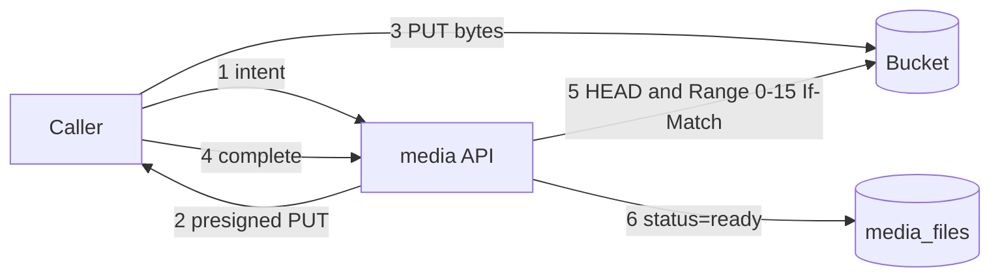

# ADR-0002 — Bytes go direct to an S3-compatible store; the API only signs and verifies

- Status: accepted (retro-documented)
- Date of evidence: 2026-10-15 (runtime), follow-ups 2026-10-29 (F1a, F1b, F2, content-type gate)

## Context

API มี body cap 1 MiB และ timeout 30 s (core) แต่ไฟล์ใหญ่ได้ถึง 100,000,000 bytes จึงไม่ควร stream ผ่าน API

## Decision

- `POST /v1/uploads` คืน presigned PUT ที่ sign `Content-Type`, `Content-Length`, `x-amz-checksum-sha256`
  และ `If-None-Match: *` (ห้ามเขียนทับ object ที่มีแล้ว); object key สร้างโดย server เป็น `<verified-ws>/<uuid>`
- `complete` ตรวจ HEAD (size, type, provider-computed SHA256, ETag) แล้วอ่านแค่ 16 ไบต์แรกด้วย `If-Match` ETag
  เพื่อเช็ค signature ของ content type; ไม่มี transaction ค้างระหว่าง store call (สาม phase)
- credential ของ store ต้องส่งแบบ explicit (ไม่ใช้ instance profile), endpoint ต้องเป็น HTTPS
- PUT URL ถอนไม่ได้ จึงมี purge ใน window และ `sweep` สำหรับ orphan หลังหมดอายุ

Sources: `src/platform_media/app.py`, `src/platform_media/adapters.py`, `src/platform_media/config.py`, `src/platform_media/sweeper.py`, `docs/runtime.md` (S3/R2 compatibility, Content-type validation gate, Follow-ups 2026-10-29)

## Consequences

- provider ต้องรองรับ checksum validation, conditional PUT และคืน SHA256 บน HEAD; ถ้าไม่มี completion จะ fail closed
- ความเข้ากันได้กับ R2/S3 จริงเป็น staging gate ที่ `docs/runtime.md` บันทึกว่ายังไม่ได้ทดสอบ
- browser upload ต้องตั้ง bucket CORS (ops record: ยังรอ app origins)
