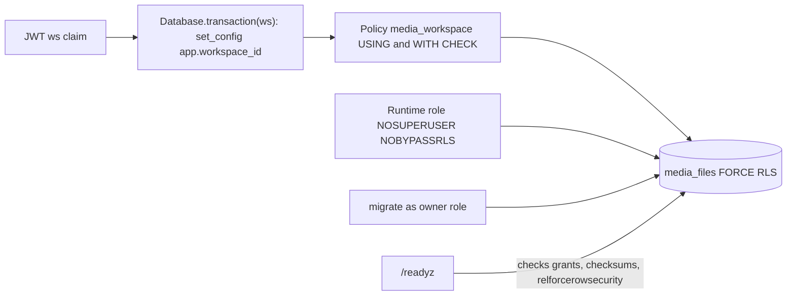

# ADR-0003 — PostgreSQL with FORCE row-level security keyed on the token workspace

- Status: accepted (retro-documented)
- Date of evidence: migration `001-media` (2026-10-15), `002-media-sweep` (2026-10-29)

## Context

service เป็น multi-tenant: ทุก request มาจาก workspace ใน JWT `ws` และต้องไม่เห็นข้อมูล workspace อื่น

## Decision

- ตาราง `media_files` เปิด `ENABLE` + `FORCE ROW LEVEL SECURITY` และ policy `media_workspace`
  เทียบ `workspace_id` กับ `current_setting('app.workspace_id')`; core `Database.transaction(workspace)` ตั้งค่านี้ต่อ transaction
- runtime role ต้องเป็น `NOSUPERUSER NOBYPASSRLS` (core ปฏิเสธ role ที่มีสิทธิ์สูง) และมีแค่ SELECT/INSERT/UPDATE
  บน `media_files` + SELECT บน `platform_schema_migrations`; ไม่มี DELETE/TRUNCATE
- migration รันแยกด้วย `DATABASE_MIGRATION_DSN` (owner role); `serve` ไม่ migrate เอง
- `/readyz` เช็ค grant ทีละตัว, checksum ของ migration และ FORCE RLS ก่อนตอบ 200
- hosting: Neon project ของตัวเอง `platform-media` (ops record)

Sources: `src/platform_media/migrations.py`, `src/platform_media/app.py` (`readiness`, `READINESS_PERMISSIONS`, `transaction`), `src/platform_media/__main__.py`, platform-backend-core `21d5f44` `db.py`, `docs/runtime.md` (Install and start, Effective runtime grants), `runtime_tests/test_readiness_grants.py`, ops record: book-platforms-status (2026-11-03, own Neon project per service, database roles recipe)

## Consequences

- การลบข้อมูลเป็น tombstone (`status='deleted'`) ไม่ใช่ DELETE row; idempotency key จองไว้ตลอด
- `sweep` ต้องรันต่อ workspace เพราะ RLS ไม่ยอมให้สแกนข้าม workspace
