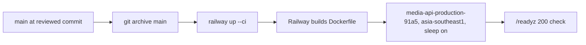

# ADR-0004 — Railway serverless in Singapore, deployed by CLI from git archive

- Status: accepted (retro-documented)
- Date of evidence: owner approval 2026-10-29 (serverless mode), redeploy 2026-11-03 (main `0f7001e`)

## Context

repo ไม่มี deploy workflow: CI (`shared-runtime.yml` job `image`) build image แต่ "never pushes or deploys"

## Decision

ตาม ops record: book-platforms-status (2026-11-03):

- service `media-api-production-91a5` บน Railway region `asia-southeast1-eqsg3a`, sleep on (serverless)
- deploy ด้วย `railway up --ci` จาก directory ที่ได้จาก `git archive main` (CLI upload ไม่ต้อง approval)
- region ต้องตรงกับ Neon Singapore เพราะ us-east4 ทำให้ query ช้า ~0.25 s
- secrets อยู่ Infisical `/platform-media` และ Railway variables

Sources: `Dockerfile`, `.github/workflows/shared-runtime.yml` (job `image` comment), `docs/runtime.md` (Staged deployment and rollback), ops record: book-platforms-status (2026-11-03)

## Consequences

- git / gh ไม่มีข้อมูล deploy โดยตรง (ดู [22-dora.md](../22-dora.md))
- cold start หลัง sleep + Neon resume ~6–9 s (core pool timeout 20 s, connect 15 s ตาม ops record)
- ไม่มี gate อัตโนมัติว่า commit ที่ deploy ผ่าน CI แล้ว: ขึ้นกับคนที่รัน CLI
