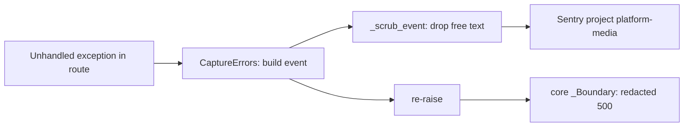

# ADR-0005 — Sentry for errors only, with no free text leaving the process

- Status: accepted (retro-documented)
- Date of evidence: first opt-in module `8faf1ca` (2026-10-29), hardened in PRs #3–#16 (2026-11-02 to 2026-11-03), main `0f7001e`

## Context

service นี้จัดการชื่อไฟล์, object key, workspace id และ token; review rounds PR #4–#13 พบว่า regex scrub
ถูก bypass ได้เสมอด้วย serialisation อีกแบบ (docstring ใน `_sentry.py`)

## Decision

- `init_sentry()` ทำงานเฉพาะเมื่อมี `SENTRY_DSN`; `traces_sample_rate=None`, `trace_propagation_targets=[]`,
  `send_default_pii=False`, `include_local_variables=False`, `max_request_body_size="never"`, log integration ปิด
- `_scrub_event` ลบ exception value, message, logentry, breadcrumbs, extra, user, request (เหลือแค่ method)
  และ dynamic sampling context; เหลือ type, stack, route template, tags, release
- `CaptureErrors` เป็น ASGI middleware ชั้นในสุด เพราะ core `_Boundary` กลืน exception เป็น 500 ก่อนถึง integration ของ Sentry
  และไม่สร้าง event เมื่อไม่มี client/transport

Sources: `src/platform_media/_sentry.py`, `src/platform_media/app.py` (`app.user_middleware.append(Middleware(CaptureErrors))`), `tests/test_sentry.py`, `runtime_tests/test_sentry_boundary.py`, `git log` (PRs #3–#16), ops record: book-platforms-status (2026-11-03)

## Consequences

- debug ด้วย Sentry ได้แค่ type + stack; ข้อความ error ต้องดูจาก log ของ Railway
- owner revert ได้ถ้าต้องการ message text (ops record)
