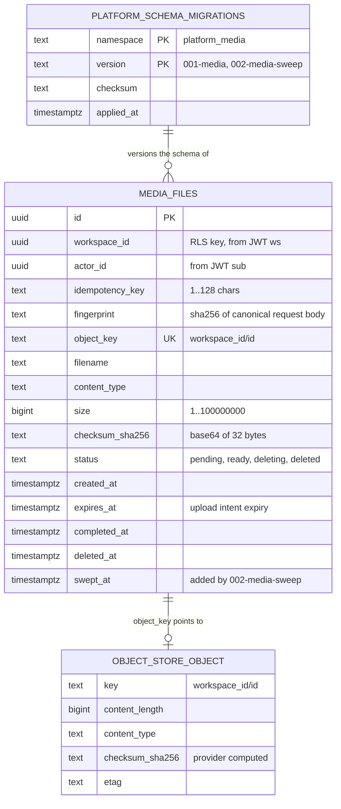

# 09 — ERD

ข้อมูลถาวรของ media API มีตารางธุรกิจเดียว `media_files` (migration `001-media` + `002-media-sweep`)
และตาราง `platform_schema_migrations` ของ core ที่เก็บประวัติ migration ต่อ namespace (`platform_media`)
ไบต์ของไฟล์อยู่ใน object store ที่ key `media_files.object_key` = `<workspace_id>/<id>`

Sources: `src/platform_media/migrations.py`, `src/platform_media/app.py` (`readiness` query on `platform_schema_migrations`, `upload` insert), `src/platform_media/adapters.py` (`head` fields), platform-backend-core `21d5f44` `migrations.py` (`CREATE TABLE IF NOT EXISTS platform_schema_migrations`, shared by all namespaces)

## Constraints, indexes, RLS

| Item | Definition |
|---|---|
| Unique | `object_key`; `(workspace_id, idempotency_key)` |
| Check | `idempotency_key` length 1..128; `size` 1..100000000; `status IN ('pending','ready','deleting','deleted')` |
| Index | `media_workspace_created (workspace_id, created_at DESC, id)`; partial `media_sweep_candidates (workspace_id, expires_at, id) WHERE swept_at IS NULL AND status <> 'ready'` |
| RLS | `ENABLE` + `FORCE`; policy `media_workspace` USING / WITH CHECK `workspace_id = nullif(current_setting('app.workspace_id', true),'')::uuid` |
| Runtime role | NOSUPERUSER NOBYPASSRLS; SELECT/INSERT/UPDATE on `media_files`, SELECT on `platform_schema_migrations`, USAGE on `public` (`READINESS_PERMISSIONS`) |
| Sweep role | same runtime role, uses SELECT/UPDATE only (`SWEEP_PERMISSIONS`) |

Graphics V1A ไม่มี database: state เป็นไฟล์ใน output directory (`manifest.json`, `design.svg`, `preview.png`,
`.locks/<job_id>.lock`) ตาม `docs/CONTRACT-SURFACE.md`

Sources: `src/platform_media/migrations.py`, `src/platform_media/app.py`, `src/platform_media/sweeper.py`, `docs/runtime.md` (Effective runtime grants), `docs/CONTRACT-SURFACE.md`

## Open questions

- retention class (UPGRADE-PLAN P0 "file-metadata contract ... retention class") ยังไม่มีคอลัมน์
