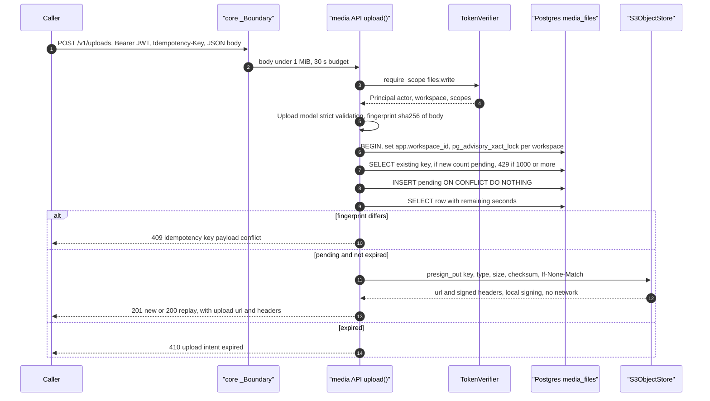
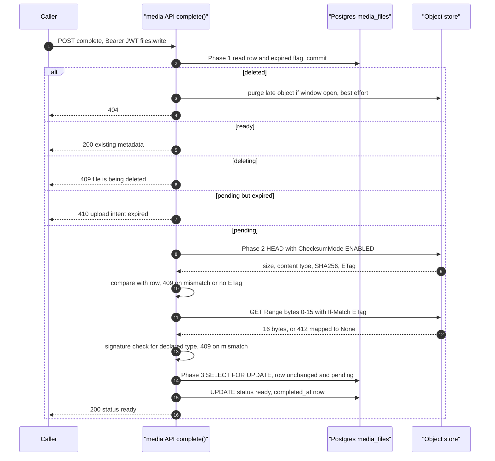
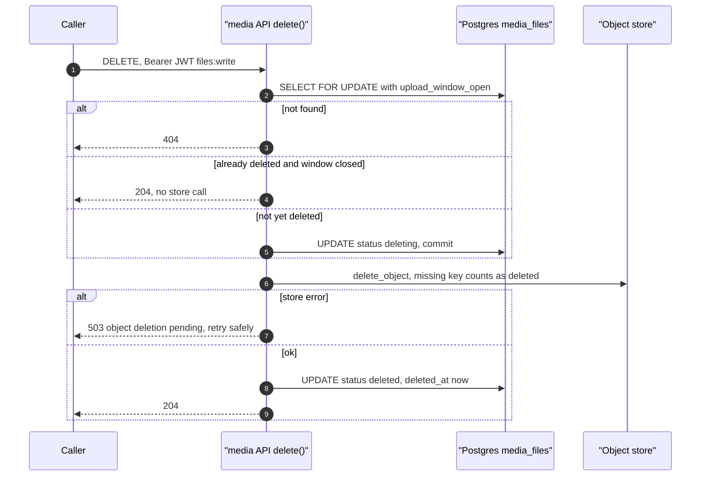
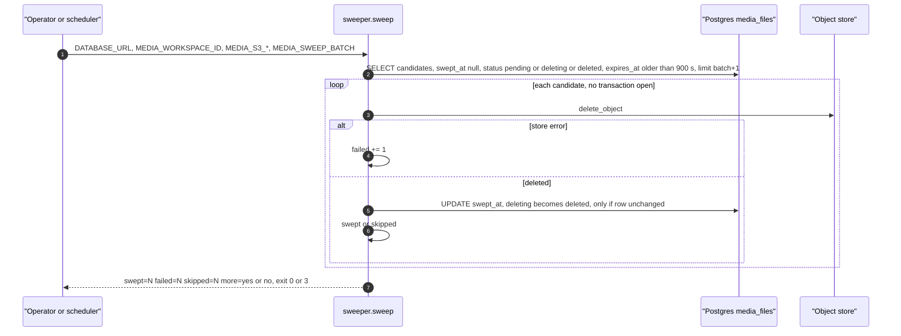

# 10 — Sequences

## 1. Create upload intent (`POST /v1/uploads`)

## 2. Complete upload (`POST /v1/uploads/{id}/complete`)

## 3. Delete file (`DELETE /v1/files/{id}`)

## 4. Orphan sweep (`python -m platform_media sweep`)

Sources: `src/platform_media/app.py` (`upload`, `complete`, `delete`, `purge_late_object`), `src/platform_media/adapters.py`, `src/platform_media/sweeper.py`, `src/platform_media/__main__.py` (`sweep_command`), platform-backend-core `21d5f44` `http.py` (`_Boundary`, `require_scope`), `auth.py`, `db.py`, `docs/runtime.md`
