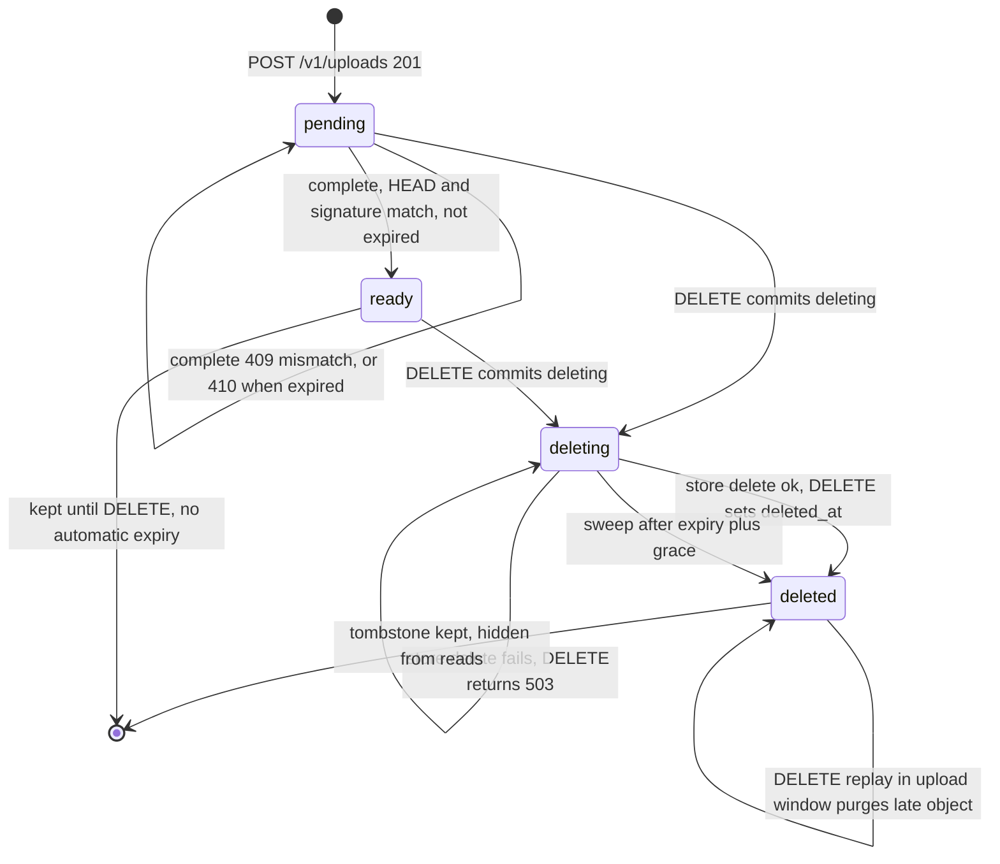
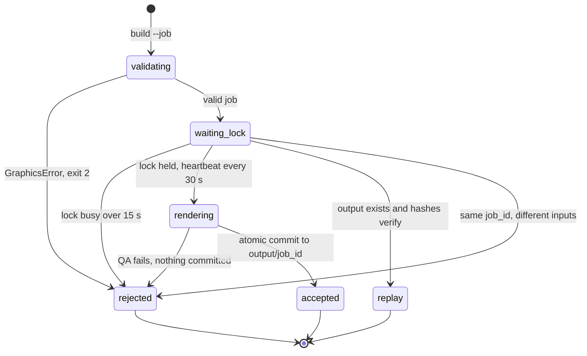
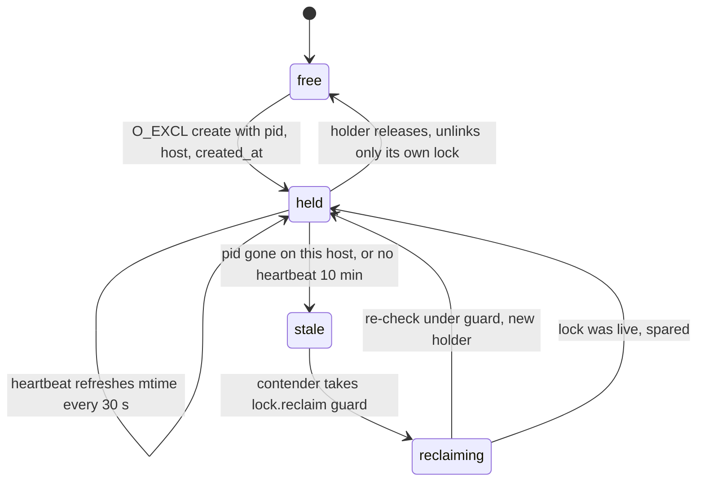

# 11 — State machines

## `media_files.status`

`status` มี CHECK constraint `pending | ready | deleting | deleted` ส่วน "expired" ไม่ใช่ status จริง:
เป็นเงื่อนไข `now() >= expires_at` ที่ทำให้ complete ตอบ 410 และทำให้ sweep เก็บ object ได้หลัง grace 900 s

Sweep ไม่เปลี่ยน status ของ `pending` และ `deleted`: แค่ลบ object และตั้ง `swept_at` (row นั้นจะไม่ถูกเลือกอีก)

Sources: `src/platform_media/migrations.py` (CHECK on status, `swept_at`), `src/platform_media/app.py` (`upload`, `complete`, `delete`, `fetch`), `src/platform_media/sweeper.py`, `docs/runtime.md` (Orphan-object sweeper)

## Graphics job result

## Graphics job lock

Sources: `book_media_platform/graphics/service.py` (`_JobLock`, `_lock_is_stale`, `_acquire_reclaim_guard`, `render_batch`, `_replay_result`), `book_media_platform/graphics/cli.py`, `docs/CONTRACT-SURFACE.md` (Behaviour notes), `tests/test_job_lock.py`
