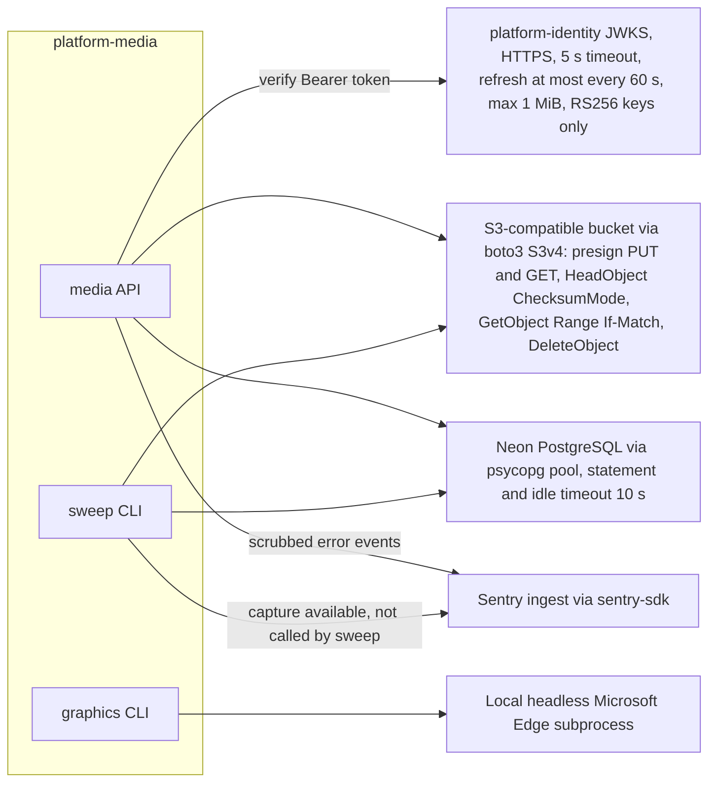

# 12 — API and integrations

รายละเอียด bounds / errors ของแต่ละ route มีอยู่แล้วใน [`docs/runtime.md`](../runtime.md) (Versioned API) และ
[`docs/CONTRACT-SURFACE.md`](../CONTRACT-SURFACE.md) (reused) ตารางนี้สรุปจาก router code

## HTTP routes

ทุก route ผ่าน core `_Boundary`: body สูงสุด 1 MiB (413), timeout 30 s (504), error ไม่คาดคิดเป็น 500 แบบ redacted,
validation error เป็น 422 `invalid request` auth: 401 ถ้า token ไม่ผ่าน, 403 ถ้าไม่มี scope

| Method | Path | Scope | Idempotency / replay | Main responses |
|---|---|---|---|---|
| GET | `/healthz` | none | read-only | 200 `{"status":"ok"}` (core) |
| GET | `/readyz` | none | read-only | 200 ready; 503 `unavailable` if no store, missing grant, migration mismatch or no FORCE RLS (media override) |
| GET | `/metrics` | none (runtime.md: protect with ingress) | read-only | Prometheus text, route template + status counters (core) |
| GET | `/docs`, `/openapi.json` | none | read-only | FastAPI defaults; `/healthz`, `/readyz`, `/metrics` excluded from schema |
| POST | `/v1/uploads` | `files:write` | `Idempotency-Key` header required (1..128); same key + same canonical body → same intent 200; different body → 409; key stays reserved after delete; advisory lock per workspace serialises creates | 201 new, 200 replay, 409, 410 expired, 429 over 1000 pending, 503 store, 422 |
| POST | `/v1/uploads/{id}/complete` | `files:write` | idempotent by state: ready returns same row 200 | 200 ready, 404, 409 mismatch or deleting, 410 expired, 503 store |
| GET | `/v1/files?limit&offset` | `files:read` | read-only | 200 list; limit 1..100, offset 0..10000 |
| GET | `/v1/files/{id}` | `files:read` | read-only | 200, 404 (also for deleted / other workspace) |
| GET | `/v1/files/{id}/download` | `files:read` | read-only, new 300 s presigned GET each call | 200 `{url, expires_in: 300}`, 409 not ready, 404, 503 |
| DELETE | `/v1/files/{id}` | `files:write` | replay-safe: deleting resumes; deleted inside upload window purges again; after window 204 with no store call | 204, 404, 503 retry |

Sources: `src/platform_media/app.py`, platform-backend-core `21d5f44` `src/platform_backend_core/http.py`, `docs/runtime.md`

## CLI interfaces

| Command | Input | Output |
|---|---|---|
| `python -m platform_media serve` | `DATABASE_URL`, `JWT_ISSUER`, `JWT_AUDIENCE`, `JWT_PUBLIC_KEY` or `JWT_JWKS_URL`, `DATABASE_POOL_MAX`, `PORT`, `MEDIA_S3_*`, `SENTRY_DSN` | uvicorn on 0.0.0.0:PORT, concurrency 64, keep-alive 5 s, no access log |
| `python -m platform_media migrate` | `DATABASE_MIGRATION_DSN` | `applied N migrations` or exit 1 without DSN text |
| `python -m platform_media sweep` | `DATABASE_URL`, `MEDIA_WORKSPACE_ID`, `MEDIA_S3_*`, `MEDIA_SWEEP_BATCH` | `swept= failed= skipped= more=`, exit 0/1/2/3 |
| `python -m book_media_platform.graphics build` | `--job`, `--output`, `BOOK_MEDIA_EDGE_PATH`, `BOOK_MEDIA_FONT_DIRS` | JSON summary, exit 2 on rejected |
| `python -m book_media_platform.graphics benchmark` | `--output` | 30-output acceptance report |

Sources: `src/platform_media/__main__.py`, `src/platform_media/config.py`, `book_media_platform/graphics/cli.py`, `contract.json` (`interfaces`)

## External integrations

| Integration | Library / protocol | Bounds in code | Notes |
|---|---|---|---|
| Identity JWKS | `urllib` with no redirects (core `_JWKS`) | 5 s, 1 MiB, ≤64 keys, refresh ≤ 1 per 60 s | issuer/audience from env; ops record: issuer platform-identity, audience `media-api` |
| Object store | `boto3` client | connect 3 s, read 5 s, 1 attempt, pool 8 | explicit HTTPS endpoint + keys; `MEDIA_S3_REGION` default `auto` |
| PostgreSQL | `psycopg` pool (core `Database`) | pool timeout 20 s, connect 15 s, statement / idle-in-transaction 10 s | Neon project `platform-media` (ops record) |
| Sentry | `sentry-sdk` | errors only, no tracing | project `platform-media` (ops record) |
| Edge | subprocess (`renderer.py`) | local only | not installed in the image |

ไม่มี webhook ขาเข้าหรือขาออก และไม่มี event bus ในโค้ด

Sources: `src/platform_media/adapters.py`, `src/platform_media/_sentry.py`, `src/platform_media/sweeper.py`, `book_media_platform/graphics/renderer.py`, platform-backend-core `21d5f44` `auth.py`, `db.py`, ops record: book-platforms-status (2026-11-03)

## Open questions

- `/metrics` และ `/docs` เปิดสาธารณะบน Railway หรือไม่: `docs/runtime.md` บอกให้ป้องกันด้วย ingress แต่ไม่มีหลักฐาน config ingress
- `sweep_command` ไม่เรียก `capture()` เมื่อล้มเหลว (มี exit code แต่ไม่ส่ง Sentry): ตั้งใจหรือไม่
- event contract (เช่น `file.ready`) ยังไม่มี แม้ README จะบอกว่า platform สื่อสารผ่าน "API or event contracts"
