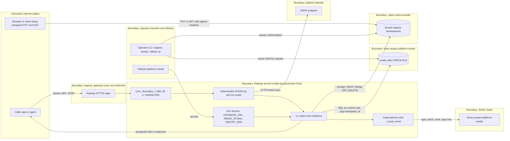

# 13 — Threat model (DFD + STRIDE)

## DFD with trust boundaries

Sources: `src/platform_media/app.py`, `src/platform_media/adapters.py`, `src/platform_media/_sentry.py`, `src/platform_media/__main__.py`, `src/platform_media/migrations.py`, platform-backend-core `21d5f44` `http.py`, `auth.py`, `db.py`, `docs/runtime.md`, ops record: book-platforms-status (2026-11-03)

## STRIDE per element

| Element | Threat | Existing mitigation in code / docs | Gap |
|---|---|---|---|
| Caller → API | **S** forged or replayed token | RS256 only, `crit` rejected, exact `iss`/`aud`, required `sub ws iat exp jti`, lifetime ≤ 3600 s, `del`/`obo` rejected (core `auth.py`) | no `jti` replay cache; revocation not enforced (core comment "cannot enforce delegation status or revocation") |
| Caller → API | **E** cross-workspace access | workspace only from JWT `ws`; unknown body fields 422 (`extra="forbid"`); FORCE RLS; other-workspace ids return 404 | none found in code; access-control parity gate open |
| Caller → API | **D** large / slow requests, upload flood | 1 MiB body, 30 s timeout, uvicorn `limit_concurrency=64`, 1000 pending intents per workspace (429), pool max 8 | no per-caller rate limit; serverless cold start under load untested |
| API → JWKS | **S** JWKS spoofing | HTTPS only, no redirects, 1 MiB cap, RSA RS256 keys only, cache cleared on failed refresh | relies on Railway egress DNS / TLS |
| API → DB | **T/I** SQL injection, privilege misuse | parameterised SQL everywhere; runtime role NOSUPERUSER NOBYPASSRLS checked by core; minimal grants checked by `/readyz` | none found |
| API → Bucket | **T** byte swap or overwrite after ready | signed `If-None-Match: *`, provider checksum, HEAD ETag + `If-Match` range read, content signature gate | depends on provider honouring conditional PUT (staging gate, not exercised per `docs/runtime.md`) |
| Bucket objects | **I** stored HTML/script under image type | 16-byte signature check per type; `application/octet-stream` unchecked | signature ≠ well-formed file; PDFs not sanitised (runtime.md) |
| Presigned URLs | **I/R** URL leak, no revocation | PUT URL ≤ 3600 s, GET URL 300 s; response URLs not logged; late PUT purged in window + `sweep` | issued URLs cannot be revoked; sweep not scheduled yet (ops record) |
| API logs | **I** secrets in logs | core logs route template, status, correlation id only; `access_log=False`; startup errors print no config | Railway platform logs of reverse proxy not reviewed here |
| API → Sentry | **I** PII / secret egress | no free text: values, messages, breadcrumbs, request detail, user, extra dropped; no tracing, no locals | owner can choose to revert (ops record) |
| `/metrics`, `/docs` | **I** information disclosure | metrics carry route templates and counts only | no auth in code; ingress protection not evidenced |
| Operator CLI | **E/R** misuse of owner DSN, untracked deploys | migrate needs separate `DATABASE_MIGRATION_DSN`; errors hide DSN; secrets in Infisical | CLI deploys leave no git/CI audit trail (see 22-dora) |
| Graphics CLI | **T** path escape, hostile assets | relative paths only, SVG assets rejected, PNG/JPEG headers verified, assets embedded as data URIs, no URL fetch | local only; Edge sandbox depends on host |

Sources: platform-backend-core `21d5f44` `auth.py`, `http.py`, `db.py`; `src/platform_media/app.py`, `adapters.py`, `_sentry.py`, `__main__.py`; `docs/runtime.md`; `docs/graphics-v1a.md`; `docs/CONTRACT-SURFACE.md`; `runtime_tests/test_api.py`; `runtime_tests/test_sentry_boundary.py`

## Open questions

- caller เข้าทาง `gateway.bookchaowalit.com` (RS256 ที่ edge + origin lock) หรือ Railway URL ตรง: ถ้าตรง Railway URL ก็คือ public edge
- bucket CORS ยังไม่ได้ตั้ง (ops record) และ bucket policy / public access ไม่มีหลักฐานใน repo
- R2/S3 ที่ใช้จริงรองรับ `If-None-Match` บน PUT และ SHA256 บน HEAD หรือไม่ (staging gate ใน `docs/runtime.md`)
- จะเพิ่ม rate limit ต่อ caller หรือพึ่ง gateway
