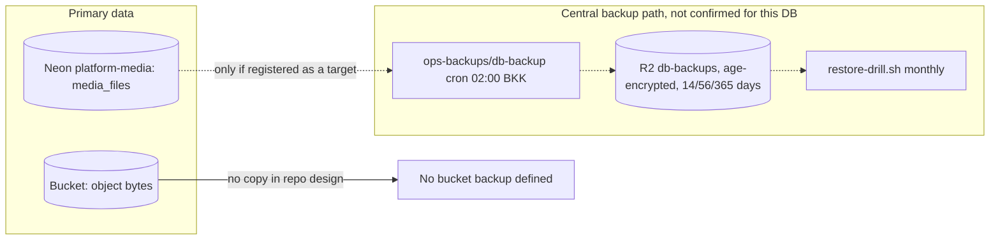
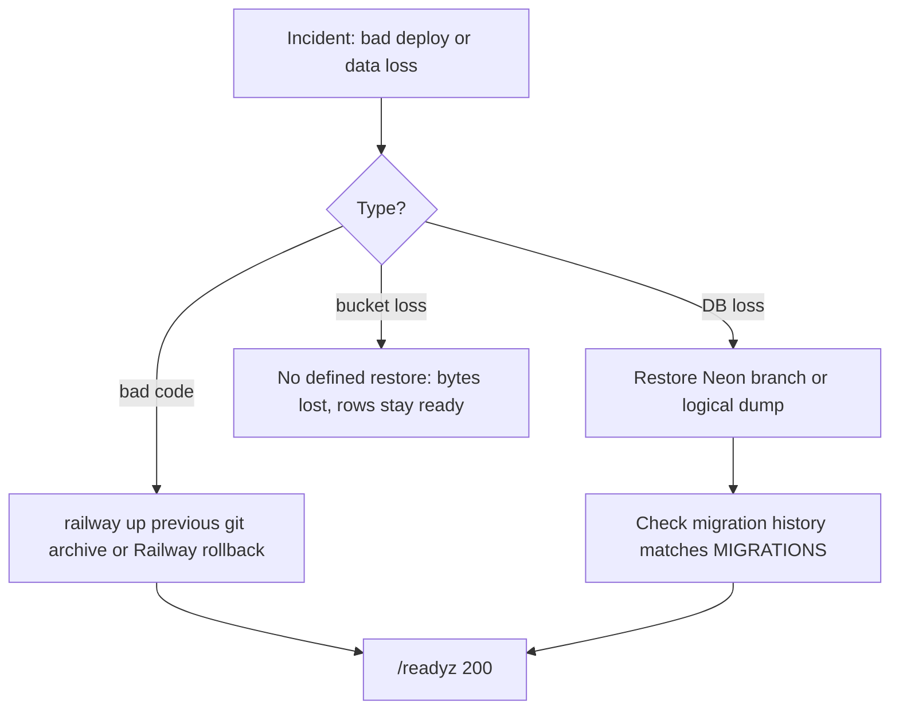

# 14 — Backup and DR

## ข้อมูลที่มีและที่อยู่

| Data | Where | Owner of copy | Backup reality |
|---|---|---|---|
| `media_files` metadata + tombstones + idempotency keys | Neon project `platform-media` (ops record) | Neon | repo ไม่มี backup workflow; Neon มี history/PITR ตาม plan ของ provider (ไม่ได้ยืนยันค่า) |
| `platform_schema_migrations` | same database | Neon | same |
| File bytes `<workspace>/<id>` | S3-compatible bucket (`MEDIA_S3_BUCKET`) | object store provider | ไม่มี replication / versioning ใน repo; lifecycle rules ตั้งแล้วตาม ops record (abort multipart 1 day, `scratch/` 7 days) |
| Secrets | Infisical `/platform-media`, Railway variables (ops record) | Infisical | นอก repo |
| Graphics outputs | local output directory | operator | ไม่มี backup; replay ตรวจ hash ได้ |

Sources: `src/platform_media/migrations.py`, `src/platform_media/config.py`, `docs/runtime.md` (Staged deployment and rollback, Bucket lifecycle rule), ops record: book-platforms-status (2026-11-03), central [ADR-0002 production baseline](https://github.com/bookchaowalit/architecture-docs/blob/main/docs/architecture/decisions/ADR-0002-production-baseline-monitoring-backups.md) (backup path for Neon databases)

## Restore / rollback ตามเอกสารของ repo

`docs/runtime.md` (Staged deployment and rollback) กำหนด: ก่อน deploy ให้ backup DB และ metadata, migrate แบบ explicit,
rollback คือกลับไป image/config ก่อนหน้าโดยไม่ drop table และต้องเก็บ object bytes ไว้
migration ใหม่ไม่มี down script; readiness ต้องการ history ครบทุก version จึง rollback image ข้าม migration ไม่ได้โดยตรง

Sources: `docs/runtime.md`, `src/platform_media/app.py` (`readiness` migration checksum compare), ops record: book-platforms-status (2026-11-03)

## RTO / RPO

- RTO: not defined
- RPO: not defined

## Open questions

- Neon `platform-media` อยู่ใน target ของ `ops-backups/db-backup` (ADR-0002) แล้วหรือยัง และ restore drill ครอบคลุมหรือไม่
- bucket จะเปิด versioning / replication หรือไม่; ถ้า bucket หายตอนนี้ row ยังเป็น `ready` แต่ download ได้ 404 จาก provider
- Neon PITR window ของ free plan ที่ใช้จริงเท่าไร
- RTO/RPO เป้าหมายของ media
