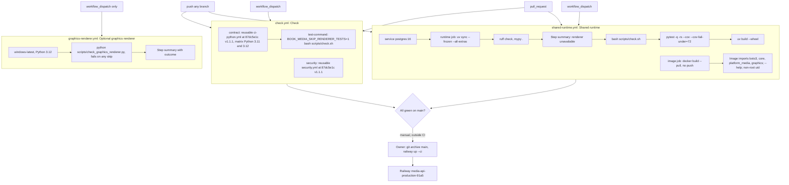

# 15 — CI/CD pipeline

สาม workflow ใน `.github/workflows/` ไม่มี workflow ไหน deploy; deploy เป็น CLI (`railway up`) ตาม ops record

Sources: `.github/workflows/check.yml`, `.github/workflows/shared-runtime.yml`, `.github/workflows/graphics-renderer.yml`, `scripts/check.sh`, `scripts/check_graphics_renderer.py`, `docs/ci-renderer-gates.md`, `tests/test_build_hygiene.py` (SHA-pin rule), ops record: book-platforms-status (2026-11-03, deploy recipe)

| Workflow | Triggers | Jobs | Concurrency | Permissions |
|---|---|---|---|---|
| `check.yml` | push, pull_request, workflow_dispatch | `contract` (matrix 3.11/3.12), `security` | `check-<ref>`, cancel in progress | `contents: read` |
| `shared-runtime.yml` | push, pull_request, workflow_dispatch | `runtime` (15 min, postgres:16), `image` (15 min) | `shared-runtime-<ref>` | `contents: read` |
| `graphics-renderer.yml` | workflow_dispatch | `renderer` (windows-latest, 20 min) | `graphics-renderer-<ref>` | `contents: read` |

ทุก `uses:` pin ด้วย commit SHA (`actions/checkout@11d5960a…` v4, `actions/setup-python@a26af69b…` v5, reusable workflows `@87dc5e1c…` v1.1.1)

## Open questions

- `graphics-renderer.yml` เคยถูก dispatch และผ่านหรือยัง (`docs/ci-renderer-gates.md`: "has not been run or accepted")
- ตามนโยบาย CI hosting repo นี้เป็น public จึงใช้ GitHub-hosted runner: ยืนยัน visibility ของ repo
- ไม่มี CD workflow: จะย้ายไป deploy จาก CI (เช่น Railway GitHub source) หรือคง CLI
