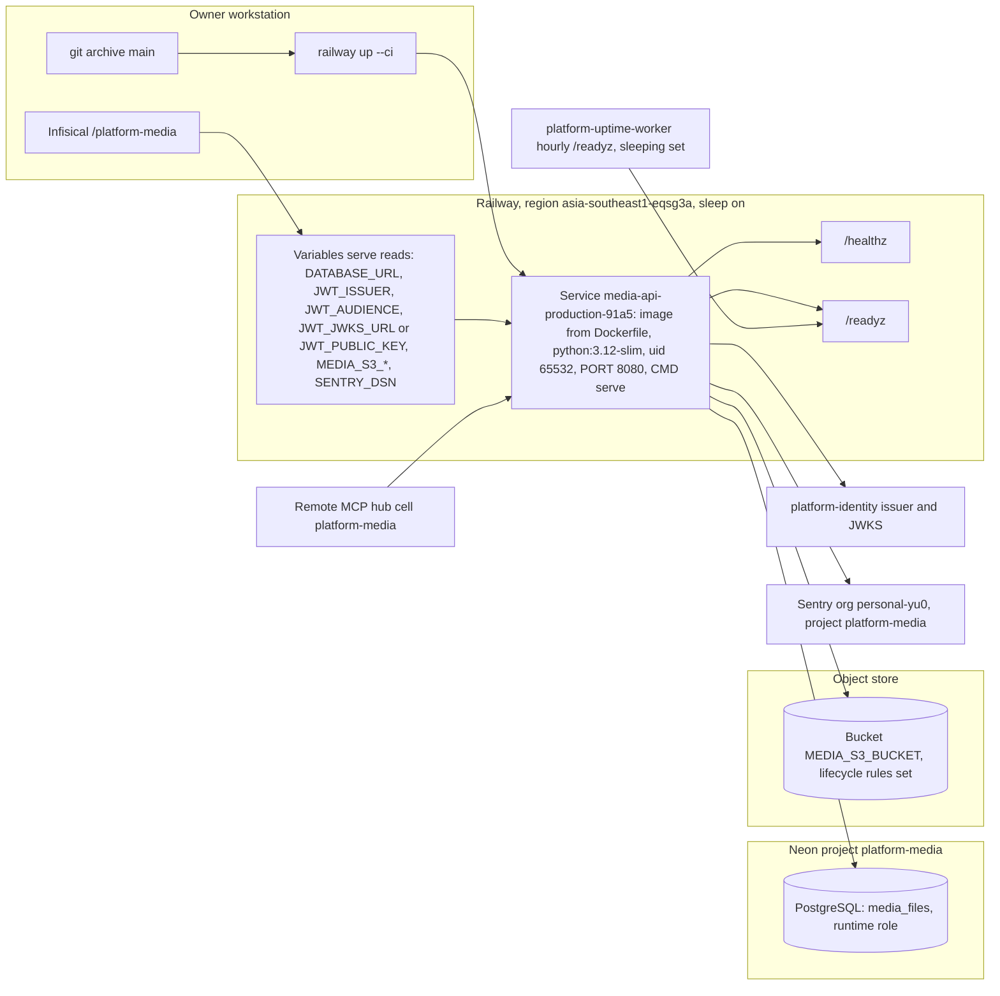

# 16 — Deployment

Sources: `Dockerfile`, `src/platform_media/__main__.py`, `src/platform_media/config.py`, `src/platform_media/_sentry.py` (`RAILWAY_GIT_COMMIT_SHA`, `RAILWAY_SERVICE_NAME`), `docs/runtime.md` (Install and start, Container image), ops record: book-platforms-status (2026-11-03)

| Item | Value | Source |
|---|---|---|
| Host | Railway service `media-api-production-91a5` | ops record |
| Region | `asia-southeast1-eqsg3a` | ops record |
| Mode | serverless (sleep on); `/readyz` 200 ~0.4 s warm | ops record |
| Last recorded deploy | main `0f7001e`, CLI, `/readyz` 200, `sentry: enabled` logged | ops record (2026-11-03) |
| Image | 2-stage `python:3.12-slim`, core `21d5f44`, non-root `65532:65532` | `Dockerfile` |
| Health | `/healthz` always 200 (process up); `/readyz` checks store config, grants, migrations, FORCE RLS, no remote store call | `src/platform_media/app.py`, core `http.py` |
| DB | Neon project `platform-media`, runtime role NOSUPERUSER NOBYPASSRLS | ops record, `docs/runtime.md` |
| Secrets | Infisical `/platform-media` → Railway variables | ops record |
| JWT | issuer `https://identity-api-production-fad1.up.railway.app`, JWKS `/.well-known/jwks.json`, audience `media-api` | ops record (pattern `<svc>-api`) |
| Not deployed | Graphics V1A renderer (no Edge/Arial in image); `sweep` schedule | `docs/runtime.md`, ops record |

## Open questions

- public domain ของ service (Railway generated domain หรือ custom domain) และ gateway route: ไม่มีใน repo / ops record ของ media
- Railway healthcheck path ที่ตั้งไว้ (`/healthz` หรือ `/readyz`) ไม่มีบันทึก
- main ปัจจุบัน `f3b4a72` (CI/lock change) ใหม่กว่า commit ที่ deploy `0f7001e`: ต้อง redeploy หรือไม่ (ไม่กระทบ runtime code ส่วนใหญ่ แต่แตะ `renderer.py`, `service.py`)
- staging environment ที่ `docs/runtime.md` ต้องการก่อน production ไม่มีหลักฐานว่าใช้
