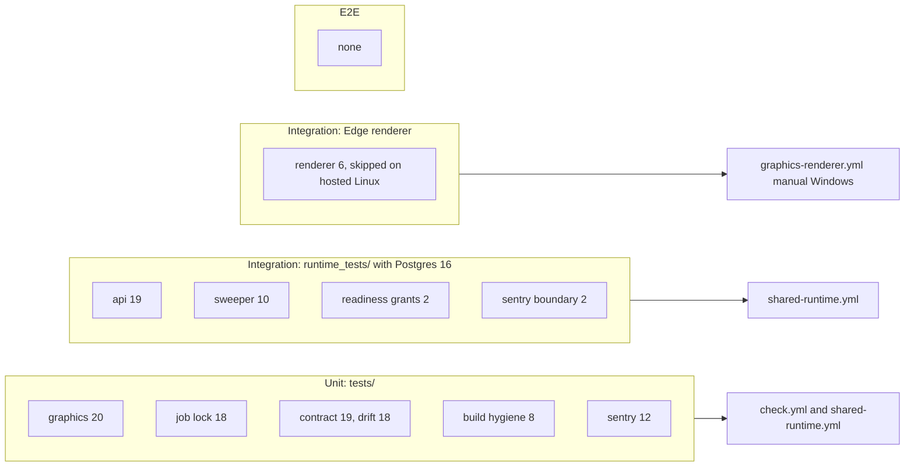

# 17 — Test coverage matrix

ระดับ test ใน repo นี้:

- **Unit (offline)**: `tests/` รันด้วย `python3 -m unittest discover -s tests` ผ่าน `scripts/check.sh` (stdlib, ไม่มี DB)
- **Integration**: `runtime_tests/` ใช้ PostgreSQL จริง (`PLATFORM_TEST_DSN`, CI ใช้ service `postgres:16`), store แบบ in-memory
  หรือ boto3 Stubber ไม่มี network; `tests/test_graphics_renderer.py` ใช้ Edge จริง (skip ใน hosted CI)
- **E2E**: ไม่มี test ที่ยิง service ที่ deploy แล้ว หรือ bucket จริง

จำนวน test function: `tests/` 101 (graphics 20, job lock 18, renderer 6, contract 19, drift 18, build hygiene 8, sentry 12),
`runtime_tests/` 33 (api 19, sweeper 10, readiness grants 2 (parametrised), sentry boundary 2 (parametrised))

| Feature | Unit | Integration | E2E | Gap |
|---|---|---|---|---|
| Upload intent, idempotency, workspace isolation | – | `test_api.py` `test_upload_intent_is_bound_idempotent_and_workspace_isolated`, `test_concurrent_uploads_and_force_rls` | – | real bucket |
| Request bounds, no caller authority | – | `test_api.py` `test_expiry_limits_and_no_caller_authority` | – | – |
| Pending quota 1000 | – | `test_api.py` `test_pending_upload_queue_is_bounded_per_workspace_and_replay_still_works` | – | – |
| JWT and scope | – | `test_api.py` `test_authorization_is_from_real_verified_jwt_and_concrete_scope` | – | JWKS path against real identity |
| Two API pools share RLS | – | `test_api.py` `test_two_independent_api_pools_share_intent_and_rls` | – | – |
| Complete: HEAD, ETag, no lock during store call | – | `test_api.py` 4 cases (swapped object, no ETag, no row lock, delete during verification) | – | provider conditional PUT not exercised |
| Content-type gate | – | `test_api.py` fixture coverage, 13 synthetic cases, fail-closed, bounded range | – | – |
| Download | – | inside `test_upload_intent_...` (409 → 200 → 404) | – | – |
| List / pagination | – | inside `test_upload_intent_...` and `test_expiry_limits_...` (limit 101 → 422) | – | offset bounds not asserted |
| Delete, late PUT purge | – | `test_api.py` `test_late_put_after_delete_is_removed_within_the_upload_window` | – | – |
| S3 adapter signing / HEAD / range / delete | – | `test_api.py` 3 Stubber cases, `test_sweeper.py` `test_s3_adapter_delete_is_idempotent_and_surfaces_other_errors` | – | real R2/S3 |
| Missing store fails closed | – | `test_api.py` `test_missing_store_fails_closed` | – | – |
| Readiness: grants, migrations, RLS | – | `test_readiness_grants.py` 2, `test_api.py` `test_readiness_requires_provider_and_migrated_rls_schema`, `test_sweeper.py` `test_readiness_requires_the_sweep_migration` | – | – |
| `/healthz` | – | `test_api.py` (asserted inside readiness test) | – | – |
| `/metrics` | – | – | – | **no test in this repo** |
| Sweeper | – | `test_sweeper.py` 10 (incl. CLI exit codes 0/1/2/3) | – | scheduling |
| `migrate` CLI command | – | – | – | **no direct test of `__main__ migrate`** (migrations applied by fixture) |
| `serve` CLI config errors | – | – | – | **not tested** |
| Sentry no free text | `test_sentry.py` 12 | `test_sentry_boundary.py` 2 (real client, 55 cases per ops record) | – | – |
| Graphics validation, replay, atomic commit | `test_graphics.py` 20 | – | – | – |
| Graphics job lock | `test_job_lock.py` 18 | – | – | Windows `_pid_alive` (UPGRADE-PLAN P1) |
| Graphics rendering with Edge, goldens | – | `test_graphics_renderer.py` 6 (skipped in hosted CI; manual Windows gate) | – | no recorded accepted run |
| Contract and schema pin | `test_contract_check.py` 19, `test_drift_checks.py` 18 | – | – | registry alignment not in CI |
| Build hygiene (Dockerfile, SHA pins) | `test_build_hygiene.py` 8 | CI job `image` | – | – |

Coverage gate: `pytest --cov --cov-fail-under=72` (measured 72.92% on 2026-11-03 with renderer skipped, comment in `shared-runtime.yml`)

Sources: `tests/*.py`, `runtime_tests/*.py`, `scripts/check.sh`, `pyproject.toml` (`testpaths`), `.github/workflows/shared-runtime.yml`, `.github/workflows/check.yml`, `docs/ci-renderer-gates.md`, `docs/runtime.md` (Verification sections), `fixtures/gates/media-content-type.json`

## Open questions

- ต้องการ smoke / E2E หลัง deploy (upload → complete → download → delete กับ bucket จริง) หรือไม่ ใครถือ token
- ควรเพิ่ม test ให้ `/metrics` และ `migrate` / `serve` CLI หรือไม่
