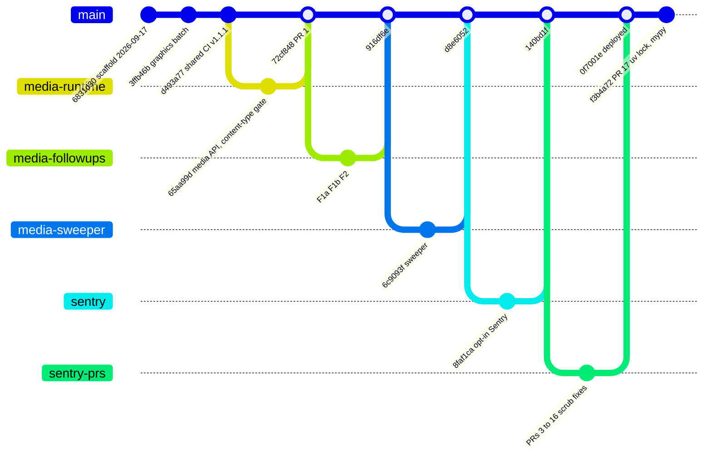
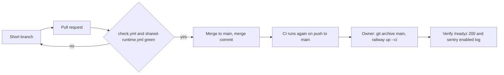

# 18 — Git and release workflow

จาก `git log --first-parent origin/main` และ `gh pr list`: งานทำบน branch สั้น (เช่น `media-runtime`, `media-followups`,
`build-hygiene`, `media-sweeper`, `sentry`), เปิด PR, CI เขียว, merge เข้า `main` ด้วย merge commit
("Merge PR #N: ...") แล้ว owner deploy ด้วย CLI จาก `git archive main` ไม่มี tag / GitHub release

Sources: `git log --first-parent origin/main --format='%h %ad %s' --date=short`, `gh pr list -R bookchaowalit-backend/platform-media --state all`, `.github/workflows/*.yml`, `docs/runtime.md` (branch names in Verification sections), ops record: book-platforms-status (2026-11-03, deploy recipe and `0f7001e`)

ข้อสังเกต: gitGraph ย่อประวัติ: `sentry-prs` เป็นตัวแทนของ PR #3–#16 ซึ่งแต่ละตัวมี branch และ merge commit ของตัวเอง (`bfbf56d` … `0f7001e`); merge core pin `6a6b912`, `83de039` และ build hygiene `0f87511` ไม่ได้วาด; PR #17 (`f3b4a72`) ลง main แบบไม่มี merge commit

## Open questions

- branch protection / required checks บน `main` ตั้งไว้อะไร (ดูจาก repo ไม่ได้)
- PR #2 ยัง OPEN (2026-11-02) และ ops record บอกว่ามี PR ซ้ำจาก branch `sentry-hardened-scrubber` ค้าง: ควรปิดหรือไม่
- ต้องการ tag / release version (pyproject ยังเป็น `0.1.0`) เพื่อผูก deploy กับ commit หรือไม่
