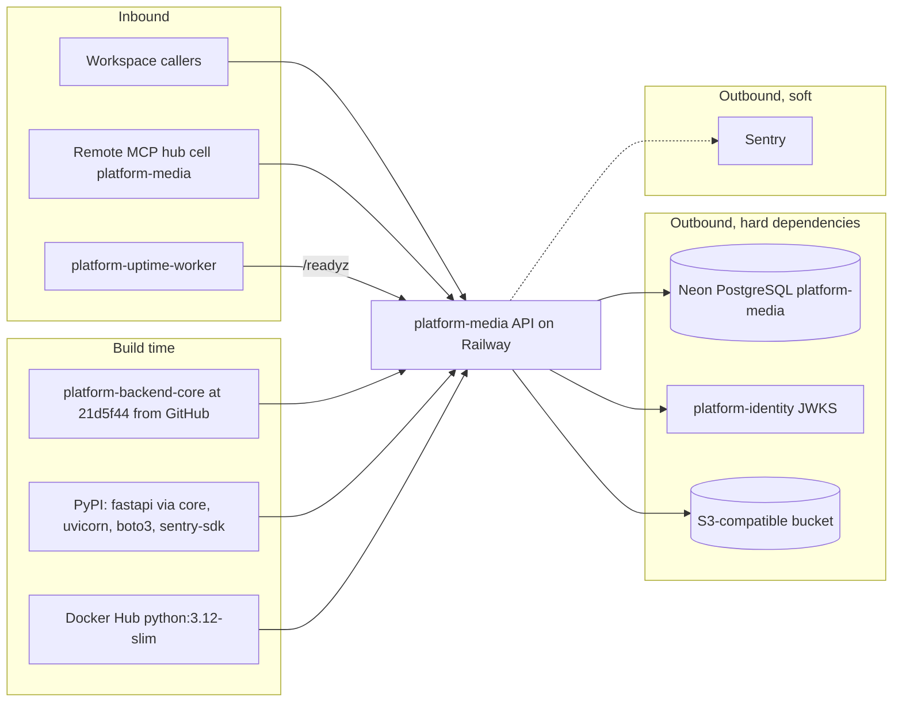

# 19 — Service dependency map (runtime)

| Dependency | Failure effect (from code) |
|---|---|
| Neon PostgreSQL | `/readyz` 503; API requests fail (core pool waits up to 20 s for Neon resume) |
| Identity JWKS | token verification fails → 401 for all v1 routes; keys cleared on failed refresh |
| Object store | config missing → 503 on uploads/complete/download/delete and `/readyz` 503; provider error → 503 per call; `/readyz` does not call the store |
| Sentry | no effect on requests; no-op when DSN unset |
| Build: core Git, PyPI, base image | image build fails; running service unaffected |

Sources: `pyproject.toml`, `Dockerfile`, `src/platform_media/app.py`, `src/platform_media/adapters.py`, `src/platform_media/_sentry.py`, platform-backend-core `21d5f44` `auth.py`, `db.py`, `docs/runtime.md`, ops record: book-platforms-status (2026-11-03: Neon project, identity issuer, uptime worker, MCP hub)

ไม่มี service-to-service call ขาออกไปยัง platform service อื่น (security, observability ที่ `contract.json` ประกาศไว้ยังไม่ได้ wire)

## Open questions

- consumer ขาเข้าจริงนอกจาก hub และ uptime worker มีใครบ้าง
- ถ้าเข้าผ่าน edge gateway, gateway เป็น dependency ขาเข้าอีกตัว (ยังไม่ยืนยันสำหรับ media)
