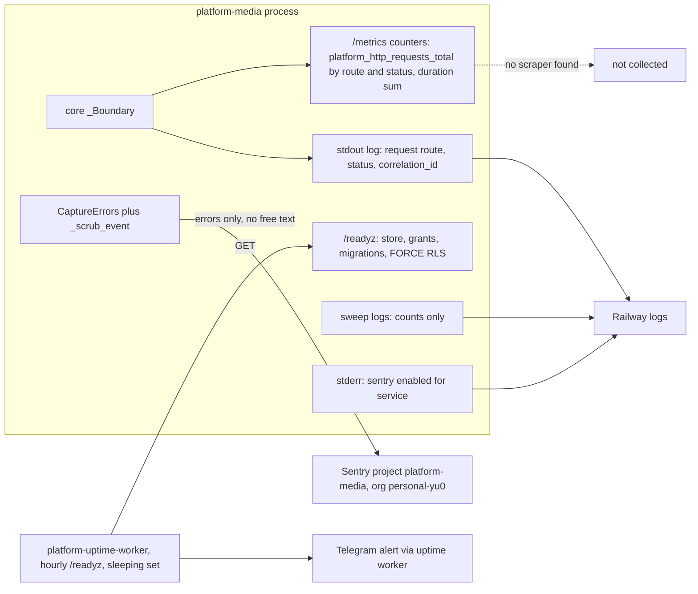

# 20 — Observability

Sources: platform-backend-core `21d5f44` `http.py` (`_Boundary` log line, `/metrics`), `src/platform_media/app.py` (`readiness`), `src/platform_media/_sentry.py`, `src/platform_media/sweeper.py` (count-only logs), ops record: book-platforms-status (2026-11-03: Sentry projects, uptime worker, observability is a library with no scraper), central [ADR-0002 production baseline](https://github.com/bookchaowalit/architecture-docs/blob/main/docs/architecture/decisions/ADR-0002-production-baseline-monitoring-backups.md) (uptime Worker + Telegram alerts)

| Signal | Emitted by | Collected by | Watched |
|---|---|---|---|
| Unhandled exceptions (type, stack, route, tags, release `RAILWAY_GIT_COMMIT_SHA`) | `CaptureErrors`, `capture()` | Sentry `platform-media` | Sentry alert rules: not recorded |
| Readiness | `/readyz` | uptime worker, hourly | yes (Telegram per ADR-0002) |
| Request log lines | core `_Boundary` | Railway logs | ad hoc |
| Request metrics | `/metrics` | none | no |
| Sweep result | `sweep` stdout + exit code | whoever runs it | `docs/runtime.md` says alert on exit 1/3 and persistent `more=yes`; no scheduler yet |
| Pending / deleting backlog | – | – | `docs/runtime.md` asks to monitor; no query or job exists |

## Open questions

- Sentry alert rule และปลายทาง (email / Telegram) ของ project `platform-media` คืออะไร
- ใครจะ scrape `/metrics` (ops record: observability เป็น library, scraper จะปลุก service ที่ sleep) — owner decision
- monitor ของ pending/deleting backlog และ heartbeat ของ `sweep` เมื่อมี schedule
- PostHog / product analytics ไม่เกี่ยวกับ backend นี้ (ไม่พบในโค้ด)
