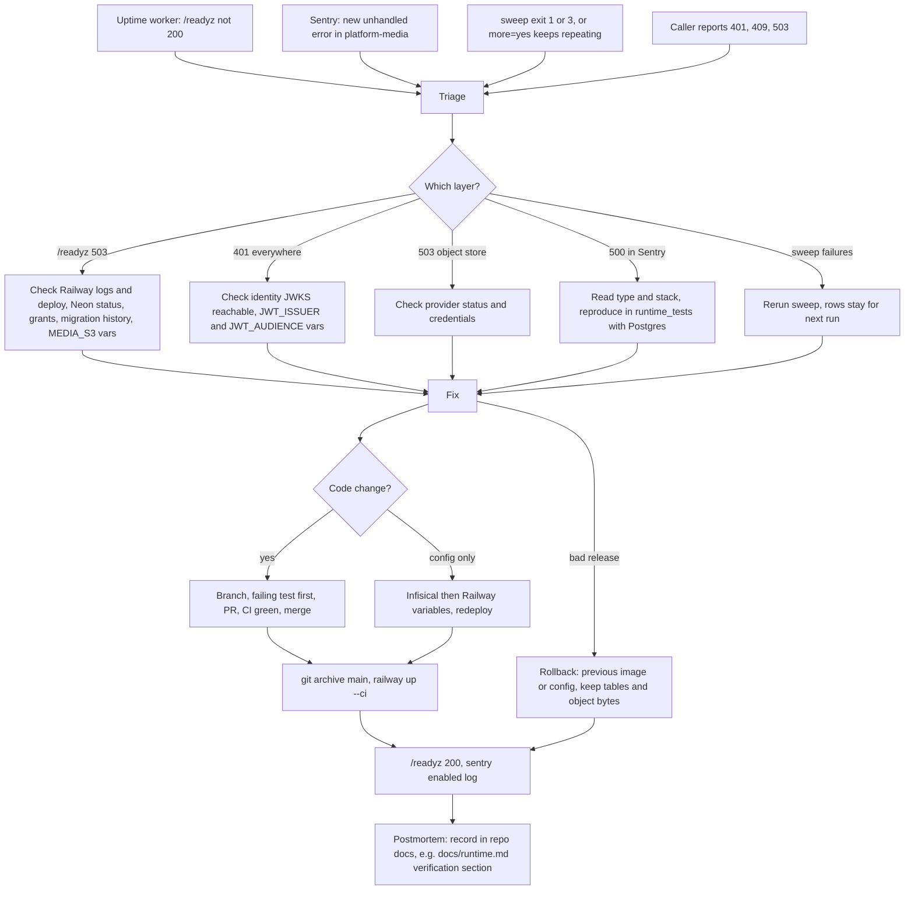

# 21 — Incident response

repo นี้ไม่มี `RUNBOOK.md`; flow ข้างล่างประกอบจาก alert channel ที่มีจริง (uptime worker → Telegram, Sentry),
ข้อกำหนดใน `docs/runtime.md` (Staged deployment and rollback, Orphan-object sweeper) และ deploy recipe ใน ops record

Sources: `docs/runtime.md` (Staged deployment and rollback, Orphan-object sweeper exit codes, Verification sections with RED/GREEN), `src/platform_media/app.py`, `src/platform_media/__main__.py`, `src/platform_media/_sentry.py`, ops record: book-platforms-status (2026-11-03: uptime worker, Sentry, deploy recipe), central [ADR-0002](https://github.com/bookchaowalit/architecture-docs/blob/main/docs/architecture/decisions/ADR-0002-production-baseline-monitoring-backups.md) (Telegram alert path)

ตัวอย่างจริงของ loop นี้ใน git: ชุด PR #4–#16 (2026-11-02/03) ที่แก้ Sentry scrub ทีละ bypass จนเปลี่ยนเป็น
"no free text" และ verification sections ใน `docs/runtime.md` ที่บันทึก RED → GREEN ของแต่ละ finding

## Open questions

- severity levels, on-call และ response time ไม่ได้กำหนด
- ที่เก็บ postmortem มาตรฐาน (repo docs, knowledge store, หรือ Linear) ยังไม่ชัด
- ควรเพิ่ม `docs/RUNBOOK.md` ให้ service นี้หรือไม่
