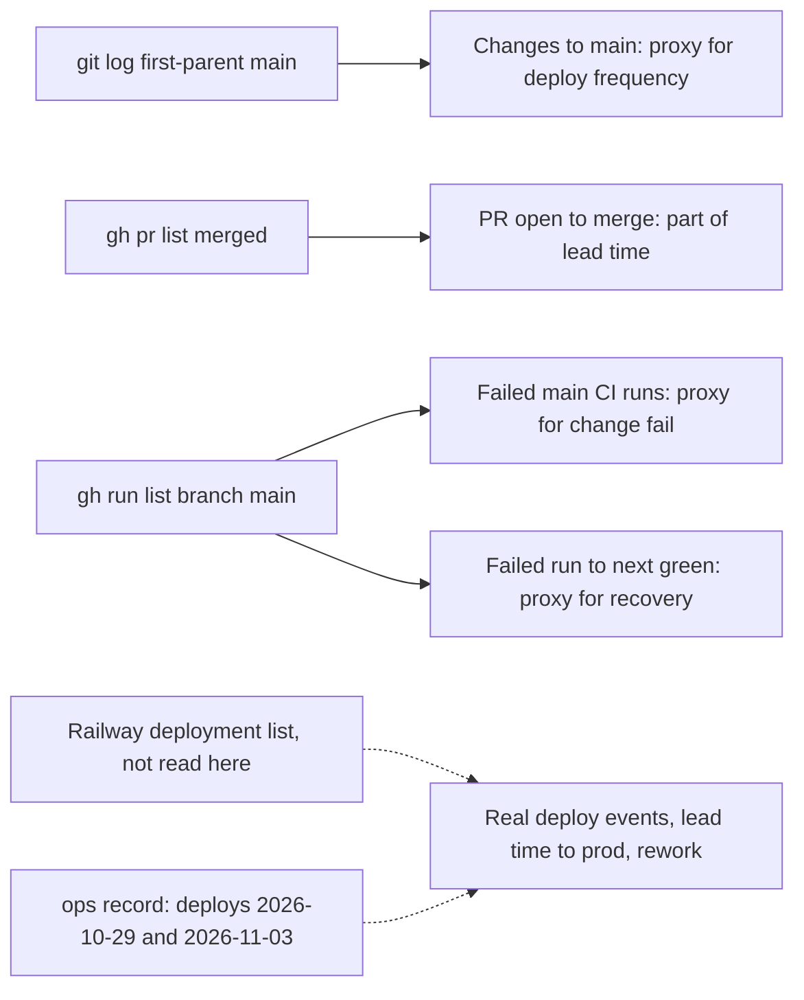

# 22 — DORA metrics

ช่วงเวลา: 90 วันถึง 2026-11-03 (`--since=2026-08-05`) repo เริ่ม 2026-09-17 จึงครอบทั้งประวัติ

ข้อจำกัดหลัก: production deploy ของ service นี้เป็น CLI (`railway up --ci` จาก `git archive main`, ops record)
ไม่มี deploy workflow, ไม่มี tag, ไม่มี GitHub deployment record ดังนั้น git / gh บอกได้แค่ "การเปลี่ยนแปลงที่ลง main
และผล CI" ไม่ได้บอกว่า deploy เมื่อไร ค่าที่ต้องการ deploy event จริงต้องดึงจาก Railway deployments



Sources: `git log`, `gh pr list`, `gh run list` (commands below), ops record: book-platforms-status (2026-11-03)

| Metric | How measured here | Value (90 days) | Status |
|---|---|---|---|
| Deployment frequency | Real: Railway deploys (not in git). Known from ops record: first live 2026-10-29, redeploy `0f7001e` 2026-11-03 → at least 2 production deploys. Proxy: first-parent commits on `main` | ≥ 2 deploys (ops record); 37 main changes on 10 distinct days | partial: deploy count is a lower bound |
| Lead time for changes | PR created → merged (gh); merge → deploy unknown | median 5.1 min, min 2.2, max 19.8, n = 15 merged PRs | partial: commit → production not computable |
| Change fail rate | Proxy: failed `Check` / `Shared runtime` runs on push to `main` ÷ main runs; reverts in git | `Check` 3 failed of 31 main runs (9.7%); `Shared runtime` 0 of 23; 0 reverts | proxy only: no production failure records |
| Failed deployment recovery time | Proxy: time from a failed main CI run to the next green main run | 2026-10-13 03:36 → 05:37 UTC (2 h 01 m); 2026-10-22 09:41 → 09:44 UTC (3 m) | proxy only: no production incident timeline |
| Deployment rework rate | Real: unplanned deploys caused by a production incident (needs Railway + incident log) | not computable; note: 14 consecutive `fix(sentry)` PRs (#3–#16) were review-driven rework before the recorded `0f7001e` deploy, not incident-driven | not computable |

## Commands used

```bash
# deployment frequency proxy
git log --first-parent origin/main --since=2026-08-05 --oneline | wc -l          # 37
git log --first-parent origin/main --since=2026-08-05 --format='%ad' --date=short | sort -u | wc -l   # 10
git log --since=2026-08-05 -i --grep=revert --oneline | wc -l                    # 0

# lead time (PR open -> merge, minutes)
gh pr list -R bookchaowalit-backend/platform-media --state merged --limit 100 \
  --json number,createdAt,mergedAt \
  --jq '[.[]|((.mergedAt|fromdateiso8601)-(.createdAt|fromdateiso8601))/60]|sort|{n:length,median:.[length/2|floor],min:.[0],max:.[-1]}'

# change fail / recovery proxies (CI on main)
gh run list -R bookchaowalit-backend/platform-media --branch main --limit 300 --created '>=2026-08-05' \
  --json workflowName,conclusion,createdAt,headSha \
  --jq '.[]|"\(.createdAt) \(.workflowName) \(.conclusion) \(.headSha[0:7])"' | sort
```

failed main runs: `21740b1` และ `8bb0cd9` (2026-10-13, rename to platform-media / schema accepts platform-* names, แก้ด้วย `cc3ec52`)
และ `3eb6482` (2026-10-22, PRODUCT.md, แก้ด้วย `d493a77` Ruff EXE001)

## Open questions

- อนุญาตให้อ่าน `railway deployment list` ของ service `media-api-production-91a5` เพื่อคำนวณ deploy frequency, lead time ถึง production และ rework จริงหรือไม่
- ควรให้ทุก CLI deploy บันทึก commit SHA ไว้ที่ไหนสักที่ (เช่น tag หรือ GitHub deployment) เพื่อให้ DORA วัดจาก git ได้
- incident log ของ media ไม่มี: change fail rate และ recovery time จริงต้องมีที่บันทึก incident ก่อน
